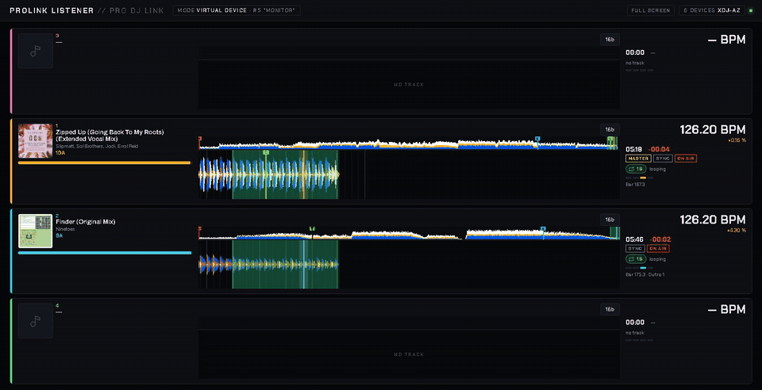
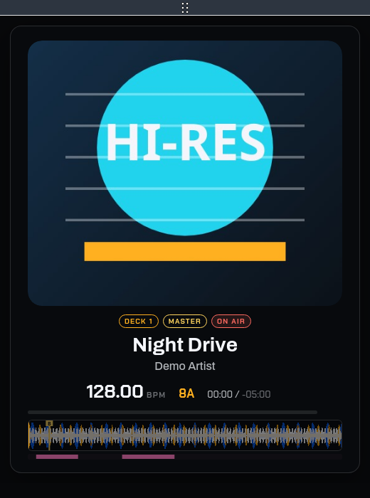

# prolink-monitor

A live Pro DJ Link monitor. It joins the booth network as a virtual player, reads the library and analysis from the player while the set is running, and draws decks, waveforms, and artwork on this computer. It is read-only toward the player and the USB stick: it never writes a Rekordbox database, never sends library edits, and a packet capture only records what already arrived.

This is a fork of [fidow/prolink-monitor](https://github.com/fidow/prolink-monitor). The desktop app is **Prolink Listener**. The current release is **1.0.23**.

## Contents

- [Documentation](#documentation)
- [What's new](#whats-new)
- [Screenshots](#screenshots)
- [Supported hardware](#supported-hardware)
- [Install](#install)
- [Features](#features)
- [HTTP API](#http-api)
- [Troubleshooting](#troubleshooting)
- [Release process](#release-process)
- [Credits](#credits)

## Documentation

Full documentation lives in [`docs/`](docs/README.md):

- [User guide](docs/user-guide.md): install, connecting, every page, web panel, OBS overlay parameters, What's Now Playing, updates, troubleshooting, FAQ
- [Architecture](docs/architecture.md): modules, threads, data flow, event stream, caching, update system, build and CI, tests
- [Protocol notes](docs/protocol.md): Pro DJ Link as implemented here (ports, packets, offsets, device numbers, dbserver, NFS, ANLZ, model profiles)
- [HTTP API](docs/api.md): every endpoint with parameters and example responses
- [Changelog](CHANGELOG.md): the per-version notes below, in one file

## What's new

**1.0.24.** Web panel on phones and tablets: below 900 px wide, deck cards take their own height and the page scrolls (the BPM block no longer sits on the waveform), decks stack one per row on phones and two per row from 600 px, the waveform gets a fixed readable height, the readouts wrap under it, text is larger, touch screens get finger-sized buttons, and the layout respects notches and home bars (safe-area insets). The desktop layout above 900 px is unchanged. Cleanup: removed unused code — Monitor.artwork_source, the PWV4 colour-overview decoders (decode_color_preview and its numpy/Python versions; the raw PWV4 tag is still read), decode_blue, _track_useful, mutagen_available, ARTWORK_SOURCES, card_corner_to_legacy_pos, NOW_STYLES / PANEL_POSITIONS, build_now_playing_preview_query, LibraryPage.set_backend, the never-read sidebar_compact setting, and unused imports. No protocol or XDJ-AZ behaviour changes.

**1.0.23.** Overlay Panel and Bar styles show elapsed / remaining time (the Panel strip never had a time readout). Title-only metadata re-asks are now bounded: the web panel and overlays stop after four tries with growing gaps, and the desktop stops once its backoff is used up, so a track without a detail analysis no longer re-fetches forever. The desktop only refreshes the Monitor when the metadata actually changed. Event streams reuse the desktop UI tick's snapshot instead of building a second one, which leaves more time for the desktop Monitor. Desktop Monitor scrolling is smooth again: the waveform cache is drawn at full screen resolution (sharp at 200% scaling) with a sub-pixel offset instead of whole-pixel steps, the 60 Hz paint timer is precise (Windows coarse timers alternated 16/31 ms frames), and the shown playhead advances evenly between status updates instead of stepping back and forth. Memory cues now show in red in the desktop Monitor, web panel and overlays (a PCO2 colour of 0,0,0 means no colour, so they were drawn black). Stored loops show as a bar along the top, like the CDJ. ProLink, dbserver and NFS code are unchanged, and the XDJ-AZ behaves as before.

**1.0.22.** Hot cue markers are back on every view (Monitor, web panel, overlays). When the dbserver title arrived before the ANLZ files were read (common on the XDJ-AZ while export.pdb is still loading, or after a slow first NFS read), the title-only entry had no cues, and every view cached it as final; the waveform turned up a moment later but the cues never did. `/api/track` now finishes the analysis before answering, the web panel and overlays fetch the metadata again when it is title-only, and the desktop Monitor replaces a title-only entry once the analysis lands. Nothing else changes; the XDJ-AZ, XDJ-XZ and the player/USB stay read-only.

**1.0.21.** Web panel and overlay performance: overlays use a lite event stream (`/api/events?lite=1`) without the Health fields; unchanged frames are skipped (re-sent at least once a second); playhead frames drop from 60 Hz to 30 Hz and are skipped while every deck is stopped; waveform and artwork use ETag revalidation (304) instead of no-store; HTML revalidates with an ETag; text and waveform responses are gzipped; overlays cache their element lookups and only write changed text; the panel reads deck colours once a second instead of every frame; hidden tabs stop painting. ProLink, dbserver and NFS code are unchanged, and the XDJ-AZ behaves as before.

**1.0.20.** XDJ-XZ only (from dysentery v0.2.2 notes; re-implemented): the XZ mixer's tempo-master handoff now treats 0x00 (no master) and 0xff (no handoff) as no handoff; the mixer's always-on synced/playing flags are no longer exposed, only tempo master; mixer BPM shows n/a unless an analysed track is playing on an XZ deck; library reads for an XZ deck fall back to the IP its status came from; and the XZ probe report records status fingerprint bytes (0x8b, 0xcc). Other models, including the XDJ-AZ, are unchanged.

**1.0.19.** XDJ-XZ only (ideas from prodj-beats, MIT; re-implemented): automatic device number tries 3, then 4, then the usual order, never a number in use; the XZ mixer's status (device 33) is decoded for mixer tempo and tempo master in the API and Health; Health no longer treats the XZ's missing master level, meters and Beat FX as missing (on-air is the reported channel state); and a Health warning appears when the XZ announces but no status is decoded within 15 s (wrong adapter, two paths or a number clash). Other models, including the XDJ-AZ, are unchanged.

**1.0.18.** Performance: the UI tick never does network or file I/O (cache-only reads, misses go to a bounded worker that emits track_ready), in-flight dedupe in ensure(), adaptive NFS timeouts (clamp(4×RTT, 0.25–0.5 s) with backoff, bounded worst case), 4 KB serial NFS reads (PROLINK_NFS_READ_SIZE 2–8 KB), numpy waveform decoding (~15–20× faster, byte-identical, pure-Python fallback), bounded LRU caches pinned to on-deck tracks, cached settings, one SSE frame per tick, and a negative cache with backoff so missing waveforms are no longer re-requested at 20 Hz. With 200 ms NFS latency, the median UI tick dropped from 809 ms to ~6 ms.

**1.0.17.** XDJ-XZ connection advice, slot names and duplicate-path warning (from Beat Link Trigger's documentation; reference only, no code copied).

- **LINK port first.** The XZ profile, README and Health now recommend the LINK port over Ethernet with **Virtual device**. **Observe only** over the USB-B cable is labelled experimental and unreliable: the built-in USB network adapter on this hardware family drops out from time to time.
- **Two network paths warning.** When the same device announces from two addresses within 10 s (for example over the USB network adapter and Ethernet at once), Health shows a warning with the tip to disable the USB network adapter.
- **Slot names.** The XZ has two USB ports and no SD: the reported "SD" slot is shown as **USB 1** and "USB" as **USB 2**. On the XDJ-AZ it is the reverse ("USB" = USB 1, "SD" or code 7 = USB 2), which matches what the AZ reports today (USB 1 as "USB"). Labels only: the NFS export is still chosen by the reported slot (`/B/`, `/C/`). Deck state gains `slot_label`.
- **Mixer on-air.** Channels On-Air packets now carry the per-channel flags (1–4, plus 5–6 on six-channel mixers), read from whichever mixer sends them, including device 33 on the XZ and AZ; they are in `/api/state` (`mixer_on_air`) and the probe report.
- **Notes.** Opus Quad: one USB at a time, and its track IDs can drift from `export.pdb`. XZ: cannot be remote controlled (this app is read-only anyway).

**1.0.16.** Health page layout fix, an honest XDJ-AZ mode label, and an optional Intel Mac build.

- **Health is readable again.** In 1.0.15 the top LINK card grew (model, all-in-one and device-number lines), but Qt does not pass the height of word-wrapped labels up through a plain card, so when the window was not tall enough the card was squeezed below its content and the column headers, the `XDJ-AZ` row, the mode label and the new lines drew over each other (clearly at 150 % scaling). The Health page now scrolls instead of squeezing, every card is kept at least as tall as its content at its current width, the overview values wrap, and the deck and NFS tables keep room for four rows at the current font size. Checked offscreen at 560–1100 px wide and 100/150/200 % scale; a layout test fails if any overview line is clipped or overlaps another.
- **XDJ-AZ mode.** 1.0.15 said *4-deck / rekordbox lighting* whenever no Channels On-Air packet had arrived in the last second, even on a live Pro DJ Link session over dbserver (that packet is not always seen, for example away from the mixer port). Now a status packet from AZ deck 1–4 in the last 5 s also means **Pro DJ Link**, the label is **unknown** for the first 5 s, and *4-deck / rekordbox lighting* is shown only after 5 s with neither packet.
- **Intel Mac build is optional.** Pull requests and tagged releases build Windows and Apple Silicon only. The Intel (x86_64) Mac app is built by hand with the new **macOS Intel build** workflow, which can attach it to an existing release.

**1.0.15.** XDJ-XZ support (untested on hardware yet), a device-model setting, and a safer device number.

- **Device model setting.** Settings → Connection → **Device model**: *Auto-detect* (default) or a fixed model — XDJ-AZ, XDJ-XZ, CDJ-3000, CDJ-3000X, CDJ-2000/NXS/NXS2, CDJ-900/NXS, XDJ-1000/MK2, XDJ-700, XDJ-RX/RX2/RX3, XDJ-RR, Opus Quad, OMNIS-DUO, DJM mixers or rekordbox. CLI: `--model xdj-xz` (see `prolink/models.py` for the keys). See [Device model profiles](#device-model-profiles).
- **All-in-ones on Health.** Units whose decks and mixer share one IP (XDJ-XZ, XDJ-AZ, Opus Quad, XDJ-RX3, OMNIS-DUO) get their own line, e.g. `XDJ-XZ @ 169.254.12.3 (#1, 2, 33)`.
- **Listen before announcing.** The virtual device waits 2.5 s, notes every number other gear announces, and never claims one already in use. The XZ says "go ahead" to any number and never defends its own, so this matters there. **Device number** now goes 0–15; **Auto** (0) picks the first free of 5, 6, 4, 3, 7…15. The default stays 5 and is kept when free, so an XDJ-AZ behaves as before apart from the 2.5 s wait.
- **Observe only (USB link) mode.** Listens on UDP 50000–50002 and sends nothing. It picks the network adapter the XZ's USB-B cable creates (usually `169.254.x.x`), falls back to tshark when another program holds the ports, and Health explains when no status packets arrive. It never opens dbserver sessions; tracks come from NFS only.
- **One library per export.** On a unit with SD and USB on the same IP, each deck's library comes from the export its slot maps to (`/B/` = SD, `/C/` = USB). Units with one export are unchanged.
- **dbserver.** Port discovery (TCP 12523) runs once per IP and is reused for 2 minutes; the client number never matches a deck or mixer number seen on the link; models without dbserver (Opus Quad, XDJ-RR, mixers) are not asked.
- **Ideas from [SuperTimecodeConverter](https://github.com/fiverecords/SuperTimecodeConverter)** (MIT), re-implemented in Python: the dbserver client number never matches a device at the target's IP (an XZ ignores requests claiming to be its own deck), taking the highest free number from 4 down to 1; number-claim packets (stages `0x00`, `0x02`, `0x04`) never count as a player, so no ghost decks; listening sockets bind to `0.0.0.0` (on macOS binding to the interface address silently drops `0x28` beat packets); keep-alives go to each address once.
- **Beat Link review fixes** (ideas re-implemented; no EPL code copied):
  - The Opus Quad reports its decks as 9–12; they are shown as 1–4, and 9–12 are never taken automatically.
  - The virtual device listens for a full 3 s discovery window (CDJs send a keep-alive every ~2 s) before announcing, and moves to another number if a final-stage claim or a "number in use" defence names ours (beat-link #91).
  - XDJ-AZ Pro DJ Link mode vs rekordbox lighting / 4-deck mode (a Channels On-Air packet from the AZ within 1 s) is shown on Health and in the detected model line.
  - Slot code 7 (USB 2) reads from the second USB export.
  - Unanalysed files (track type 2) skip the USB database lookup, which would match the wrong track, and are cached separately. Waveforms and beat grids that are not ready at load are retried after 3, 8 and 20 s.
  - Play state `0x12` (emergency loop) counts as playing; ShowKontrol (`TCS-SHOWKONTROL`) packets are ignored; the keep-alive peer count (byte `0x30`) is parsed.
- The XZ's "does not defend device numbers" note is now marked unconfirmed. Checked against dysentery #75 (CDJ-2000NXS captures): this app does not classify devices by keep-alive byte `0x25`, by status-packet length or by media-slot broadcasts, so none of its corrections needed a parsing change.
- **XZ probe report.** Health → **Export XZ probe report** saves a read-only JSON file (also `GET /api/xz-probe`): adapters, packet types heard per IP and device, device names, NFS exports, slot bytes, firmware, whether `exportLibrary.db` is present, dbserver and library errors. Nothing is sent to the player.

**1.0.14.** A macOS build, working zoom buttons with a 32-bar step, and the overview strip in the panel and bar overlays.

- **Prolink Listener for Mac.** Releases now include `ProlinkListener-<version>-macos-arm64` (Apple Silicon) and `-macos-x86_64` (Intel), each as a `.dmg` and a `.zip`, built with PyInstaller on GitHub's macOS runners. See [macOS, from the GitHub Release](#macos-from-the-github-release). The app is not signed or notarised, and it does not update itself: when a new version is out it says so and opens the Releases page.
- On macOS, settings live in `~/Library/Application Support/Prolink Listener` and the library cache in `~/Library/Caches/Prolink Listener`. Windows and Linux keep `~/.prolink-monitor` and `~/.prolink-cache`.
- The bundle's `Info.plist` carries `NSLocalNetworkUsageDescription`, so macOS 14 and later can ask for Local Network access, which Pro DJ Link needs. The network interface and its prefix are read from `ifconfig` on macOS (Windows still uses PowerShell). Fonts fall back to the system font and Menlo.
- **Zoom buttons work again.** Since the 1.0.10 wheel zoom, a saved wheel zoom (`wave_zoom_seconds_by_deck`) always took priority over the bar setting, so after one wheel move the `1 2 4 8 16` buttons and the per-deck chip changed nothing. Buttons and wheel now share one zoom state per deck: a button (toolbar, deck chip or **All**) replaces the wheel zoom with bars × 4 beats at the track's BPM, the wheel adjusts from there, and the lit button follows (none while the wheel sits between two). The web panel drops its browser-saved wheel zoom when the desktop bar setting changes.
- **32-bar zoom.** The buttons are now `1 2 4 8 16 32 All`, and the wheel reaches 96 s (32 bars at 80 BPM), up from 30 s.
- **Overview in the panel and bar overlays.** `/overlay?style=panel` and `style=bar` never had the whole-track overview strip; only the card did. Both now show it between the track row and the scrolling wave (above it with `pos=top`), with the playhead, cues and loop, in the same colours as the card. The coloured blocks in the panel are the spectrum visualiser, which is idle while the deck is stopped.
- Tests also run on macOS in CI, and `packaging/verify_bundle.py` checks a `.app` (executable, Qt WebEngine helper, web files, Info.plist and icon).

**1.0.13.** Smaller deck text and a bar counter.

- **Smaller identity text.** In each deck's left column the title, artist, key and deck number are about a third smaller, on the desktop Monitor and the web panel alike (title 22 → 14 px, artist 16 → 11 px, number 16/20 → 11 px, key 16/18 → 12 px at a 240 px row, still scaled with the row height). A title now gets two lines on any row 96 px or taller (it used to need 240 px), so a long title shows in full instead of being cut short after the first line.
- **Bar.beat counter.** The beat readout is now the standard 4/4 counter, **`Bar 33.2`** (bar 33, beat 2), followed by the phrase: `Bar 33.2 · Chorus`. The bar is computed from the player's beat-grid beat number in its status packets, and the player's own 1–4 beat counter marks the downbeat, so the bar changes on beat 1 even when the grid's first beat isn't a downbeat. The JSON state has the same text as `bar_beat`. It appears on the Monitor, the web panel, and the card, panel and bar overlays (next to the clock), and `barbeat=0` hides it on an overlay. With no beat number it falls back to `Beat 2/4`.
- Screenshots recaptured, including the overlay settings page.

**1.0.12.** The floating Now Playing window opens again. Since 1.0.7, `apply_state` and `tick_paint` had slipped out of the window class into the body of a module function during the clean-exit change. Opening the window called `apply_state` before `show()`, raised `AttributeError` inside the Qt slot, and nothing appeared and nothing was logged. Both methods are back on the class. A failure while opening is now logged and shown in a message box. A test opens the window the way the app does, and another checks that every method the main window calls exists. The drag-strip grip is sized to the 22 px strip so the top and bottom dots are no longer clipped. README screenshots were recaptured from demo data with `scripts/capture_readme_shots.py`.

**1.0.11.** The Library shows every playlist and folder, and artwork can come from the audio file.

- **Full playlist tree.** The live (dbserver) Library only asked the player for the root playlist menu and then dropped the folders, so any playlist inside a folder never appeared. It now walks every folder (one read-only folder request per folder, with a loop guard and a node cap), keeps folders as headers, and indents playlists under them. Smart playlists are listed like any other playlist. Long menus are still read in full, 64 rows at a time.
- **Fallback tree.** The NFS fallback reads the OneLibrary `playlist_id_parent` and `attribute` columns (1 = folder, 4 = smart playlist). Before, attribute 2 was treated as a folder and the parent was ignored. When OneLibrary is not available, the fallback reads `export.pdb`'s playlist tree and playlist entries.
- **Track columns.** The second line of a dbserver track row is whatever the player's sub-column is set to (album, genre, comment, key, and so on). It is now mapped by the row's item type instead of always going into Artist. A cached `export.pdb` row is only merged when its title matches, so a stick with different track ids no longer shows another track's artist or album.
- **Library diagnostics.** **Library > Diagnostics** (or `/api/library/diagnostics`) saves a read-only JSON report: folder and playlist counts and tree depth from the live player and from the USB copy, the full tree from both, and the first 20 rows of a playlist side by side.
- **Hi-res artwork from file.** Large artwork is read from the cover embedded in the audio file over NFS, with mutagen, using ranged reads of the tag region only. It loads in the background and is cached in memory and on disk; until it is ready the player's dbserver art is shown. Settings: **Hi-res artwork from file** (on by default) and **Hi-res artwork read cap (MB)** (16 by default, 1 to 64). The player and USB stay read-only.

**1.0.10.** 3-band waveforms and a zoomable scrolling wave.

- **Byte order.** PWV7 (the scrolling 3-band wave in `.2EX`) and PWV6 (the overview) are read as **low, mid, high** by default. That is the order [rbxport](https://github.com/chrisle/rbxport) both reads and writes: it measured rekordbox's own files (PWV4's bass channel tracks PWV6 byte 0 at r = 0.83–0.96 over 11 tracks, the last byte is the quiet high band with a mean near 3 against about 30 for the others, and its generated PWV7 matches rekordbox's envelopes at r ≥ 0.97). OneLibraryCompanion reads PWV7 the same way. The Deep Symmetry analysis and Beat Link say mid, high, low; that is still an option. Each tag has its own setting, `pwv7_order` and `pwv6_order`, and the log prints both. **If kick drums are not blue on 3-Band**, open **Settings > Display > 3-Band byte order (scrolling / overview)**, pick *Mid, high, low (Deep Symmetry / Beat Link)*, save, and reload the track (or set `"pwv7_order": "mid_high_low"` and `"pwv6_order": "mid_high_low"` in `settings.json`). In the default order the scrolling bands share one scale (value / 127, as rbxport draws them); the Beat Link order keeps Beat Link's band scales.
- **PWV6 overview.** The 3-band overview comes from PWV6 when the track has it: low, mid and high are stacked from the bottom at rbxport's scales, low/128, mid/256 and high/128 of the strip, and a loud column clips at the top. Tracks without PWV6 keep the PWV7 downsample. Every overview pixel max-pools the columns under it, so short hits do not drop out. The vocal lane reads PWV6 in the same order.
- **Two palettes.** *CDJ-3000* is the default: rekordbox's own 3-band colours, one for each band combination (low `#0055e1`, mid `#ffa600`, high `#ffffff`, low+mid `#b4690a`, low+high `#d2dcfa`, mid+high `#fff0d7`, all three `#f5ebd7`), as sampled from rekordbox in mixxxdj/mixxx#12326 and used by rbxport and OneLibraryCompanion. *Beat Link* is the old look: blue lows, amber mids, brown overlap, white highs. Both are defined once, in `web/wavepalette.json`, which the desktop app, the web panel and the overlays all read. Overlays take `palette=beatlink` for the old look.
- **Auto waveform style.** *Auto* follows the colour each player is set to (status byte 0xDA: 01 blue, 03 RGB, 04 3-band). When a player does not report it, Auto draws the *Auto fallback* you pick (RGB by default). Overlays take `wave=auto` and `wavefb=`.
- **Zoom.** On the Monitor, the mouse wheel over a deck's scrolling wave zooms it from 2 s to 30 s in smooth steps (×1.15 per notch). The playhead stays where it is (centre or left). Double-click resets the deck to the bar zoom. Each deck keeps its own zoom in `settings.json` (`wave_zoom_seconds_by_deck`). The web panel does the same with the wheel and a two-finger pinch, and remembers it in the browser. Overlays take a fixed `zoom=<seconds>` and have no zoom controls. Loops, cues and beat lines are placed from the same window at every zoom, the phrase strip is unaffected, and zoomed-out views max-pool so they stay sharp.

**1.0.9.** Icons are [Phosphor](https://phosphoricons.com/) SVGs instead of text symbols. The artwork placeholder is a music note, the loop badge uses Repeat, the sidebar button uses List, and ratings are filled and outlined stars. The floating overlay's drag strip uses the Dots Six Vertical grip. The Qt app recolours them to the theme, and the web panel and overlays draw them inline in `currentColor`. ON AIR, MASTER, SYNC, deck numbers, status dots, and the key stay as text.

**1.0.8.** Monitor deck rows measure their text before they draw it, so a short row no longer squashes the title over the artist or stacks the readout on itself. The title stays on one line unless the row is tall enough for two. The artist stays. Album, label, genre, and the other detail lines appear only when they fit. Artwork shrinks with the row. BPM, pitch, and the clock stay readable; tags, the beat line, and the next cue drop from the bottom when the height runs out. An empty deck is a deck number and a small “no track”. The web panel already packed its rows and is unchanged.

**1.0.7.** The Monitor and the web panel use the spare height in a deck row. Title and artist scale with the row. When there is room, the left side adds album, label, genre, year, key, rating, colour, comment, and a played bar, and the right side adds master/sync, loop, the beat and phrase, and the next cue. Rekordbox `(blank)` is not drawn. **File > Exit**, tray Quit, and a close that is set to quit stop the link sockets, the web server, the library workers, and the process.

**1.0.6.** The loop highlight on the overlay and the web panel stays on the playhead. While a loop is active the position is folded into the loop, and the wave scrolls by the device pixels it draws, so the green region does not drift at 125% and 150%. The desktop Monitor uses that same scroll. Checked with a 32-beat loop at 123.2 BPM.

**1.0.5.** Bar (`style=bar`) draws the scrolling detail wave. Panel and Bar are both that full-width strip. The spectrum on Bar still follows the spectrum switch (`spectrum=0` hides it). Panel keeps the visualiser unless `spectrum=0`.

**1.0.4.** Artwork is requested as soon as a track id is known, and a successful dbserver or NFS lookup sets `has_artwork` before the waveform arrives. If the saved web port is inside a Windows excluded range, the log and Health name that range and the server uses the next fallback. Panel is the strip with the larger cover and the visualiser. Bar is the strip with the small cover.

**1.0.3.** One bad OneLibrary date no longer blanks the library. The Library page shows the same live dbserver source as Health. Track columns keep title, artist, album, key, and BPM, and the rows are zebra-striped. `style=bar` is its own layout. Overlay URLs can lock the spectrum with `spectrum=1`. A dbserver session that never connects is not counted as a reconnect.

**1.0.2.** The Windows zip includes pyrekordbox. The Library reads the player’s dbserver first. The log rotates. The floating window has a visible drag strip.

**1.0.1.** The web server stays up across a reconnect. A second launch brings the first window forward instead of starting another process.

## Screenshots

The Monitor, web panel, and panel and bar overlays are real captures of 1.0.22 running on Windows against an XDJ-AZ with decks 1 and 2 playing. The card overlay, Library, floating window and overlay settings are from earlier captures.



The web panel live, about 14 s ([MP4](doc/web-panel.mp4)).





## Supported hardware

Field offsets, NFS, and waveform decoding were checked against an **AlphaTheta XDJ-AZ, firmware 1.30**, on Windows 11. That is the only player the original work was verified on. The desktop shell has also been run on Linux without live gear. Anything else below is what the code expects from public packet layouts, and is marked when this project has not confirmed it on hardware.

**XDJ-AZ**

- The AZ uses player numbers 1–4 and 33 (the mixer section). Rekordbox uses 17. This app announces as device **5** by default.
- **2-deck and 4-deck.** While Utility → PRO DJ LINK is on, the AZ sends a Channels On-Air packet (type `0x03` on UDP 50001). Health calls that **Pro DJ Link**. When that packet goes quiet for more than a second, Health calls it **4-deck**. With no AZ on the network the line stays blank. The Monitor page only has those two layouts: decks **1–2**, or **3–1–2–4**.
- **Source slots** in the status packet: 0 empty, 1 CD, 2 SD, 3 USB, 4 rekordbox, 6 Streaming Direct Play, 7 USB 2 (AZ 4-deck), 9 Beatport LINK. Bytes 5 and 8 are only documented as a streaming service. They are not labelled Apple Music, TIDAL, or SoundCloud.
- **OneLibrary.** The status track id is the rekordbox id. `export.pdb` is read first because that row holds the ANLZ path. `exportLibrary.db` is used when it has the same id. A readable OneLibrary file with no content rows must not hide the `export.pdb` row (that used to blank every waveform on the AZ). A title match can choose between the two when they disagree. The Library reads the player’s dbserver first, as soon as the player address is known, including while `export.pdb` is still loading. That session asks the port-discovery service on TCP **12523** for the dbserver port, then connects to the port the player returns (it is often not 1051). The client number is the virtual device this app announced (default **5**), so it does not take deck 3 on an AZ that already uses 1–4. If the decks have not announced yet, the app still opens that TCP session and targets deck 1 until a player number arrives. The NFS cache is the fallback. A bad `export.pdb` does not drop the mount or skip OneLibrary. Nothing is written back. The Windows zip includes `pyrekordbox`, `sqlcipher3`, and `sqlite3` as real files under `_internal`. A source checkout still installs OneLibrary from `requirements-onelibrary.txt`.
- **Unverified on the AZ:** Absolute Position packets (type `0x0b`). Health shows `absolute_packets` and whether the playhead is using Absolute Position or the beat grid, so a capture answers it. Some AZ builds put track length in milliseconds in that packet; CDJ-3000 uses seconds. Also unverified: the settings block at `0xD0` (waveform colour at `0xDA`, playhead at `0xDD`). Auto playhead still falls back to **Left** for an AZ (and for Opus Quad) when that byte is missing.

**XDJ-XZ** (not yet tested on hardware; please send a probe report)

The XZ shows decks 1 and 2 and its mixer (33) on one IP. It has a dbserver and serves its media over NFS. It has two USB ports and no SD slot: it reports USB 1 as "SD" and USB 2 as "USB", and the app labels them USB 1 and USB 2 (the NFS exports still follow the reported slot, `/B/` and `/C/`). It cannot be remote controlled; this app never tries, it only reads.

1. **LINK port over Ethernet (recommended).** Ethernet from the XZ's LINK port to the computer or a switch. Set **Mode → Virtual device**, **Device number → Auto**, **Device model → XDJ-XZ** or Auto-detect. Health → Device number shows which number was taken (never 1, 2 or 33).
2. **USB-B cable, Observe only (experimental, unreliable).** The XZ's built-in USB network adapter is known to drop the connection from time to time (Beat Link Trigger, *Opus Quad: Built-In USB Network Problems*, applies to the same hardware family). Plug the USB-B port in, wait for a new wired adapter (normally `169.254.x.x`), set **Mode → Observe only (USB link, experimental)**, leave **Interface** empty and press Apply. If Health says *keep-alives arrive but no player status packets*, use the LINK port.

If the USB cable is also plugged in for audio while the LINK port is used, the unit is reachable over two network paths and every packet arrives twice. Health warns about it (*seen on more than one network path*): disable the USB network adapter (macOS: System Settings → Network → that adapter → Make Inactive; Windows: Settings → Network → Advanced network settings → Disable).

Then load a track from each USB and check title, waveform and Library, and export the probe report from Health whatever the result. The probe report also lists the mixer's (device 33) channel on-air flags. Known gaps: the XZ sends no media-slot broadcasts, so slots are learned from status packets; whether status reaches a computer that does not announce itself is unknown.

**Opus Quad** (limited): no dbserver and no beat packets. Use one USB at a time, because it does not report which USB a track came from, and its track IDs (Device Library Plus) can drift from the USB's `export.pdb` IDs as the collection is edited, so a track can be misidentified.

**Device model profiles**

`prolink/models.py` holds a profile per model: deck count, the device numbers it uses, whether it is an all-in-one, whether it runs dbserver, serves NFS, sends beat and precise-position packets, which waveform colours it stores (3-band only on CDJ-3000/3000X, XDJ-AZ, Opus Quad and OMNIS-DUO), and how a laptop connects. Auto-detect uses the announced names (an all-in-one or player before a mixer, rekordbox last). Health shows the chosen or detected model, where it came from and its capabilities; hover for the connection advice. A profile only switches off requests a model cannot answer (for example dbserver on the Opus Quad); it never sends anything extra. An unknown name gets a generic profile with everything allowed, so missing features simply stay empty. Profiles marked `*` in the list are from documentation only.

**CDJ-3000 family**

- Absolute Position is the documented precise playhead: about every 30 ms on UDP 50001, type `0x0b`. This project has not re-checked that on a CDJ-3000 in the booth.
- The factory playhead default in the code is **Centre**. CDJ-2000NXS2 and XDJ-XZ have no such setting and are always centred.
- Long status packets (512 bytes) carry the loop that is actually playing. Shorter packets leave the loop fields at zero.
- The sequence counter at bytes `0xC8`–`0xCB` usually stays zero, so Health’s sequence-hole column stays blank until that counter is seen stepping by one.

Two other choices were written for separate players and are untested on a multi-CDJ booth: the medium is read from the player the track says it was loaded from, and the NFS file-name encoding is detected (the AZ uses UTF-16LE).

## Install

The computer and the player need to be on the same network. The monitor core (`app.py`, `monitor.py`, `probe.py`) needs no extra Python packages. The desktop app, the updater, and a few optional readers do.

### Windows, from the GitHub Release zip

You do not need Python for this path.

1. Open the [Releases](https://github.com/johnnycoombes/prolink-monitor/releases) page and download `ProlinkListener-<version>-win64.zip` from a versioned release (for example `v1.0.23`). Leave the release named `updates` alone. That one is signed metadata for the updater, not an installer.
2. Extract the zip to a folder you will keep, for example `C:\Users\User\Prolink Listener`. Do not run the program from inside the zip.
3. Double-click `ProlinkListener.exe`.
4. If Windows asks whether the app may use private networks, allow it. A phone on the booth Wi-Fi needs that to open the panel.
5. Settings stay in `C:\Users\<you>\.prolink-monitor\settings.json`. The USB library cache stays in `C:\Users\<you>\.prolink-cache`. A rotating log of the library source, counts, and errors is `C:\Users\<you>\.prolink-monitor\prolink-monitor.log`. The first launch does not copy or reset either folder. The zip includes `pyrekordbox`, so OneLibrary opens without a separate install.

Npcap is only needed when rekordbox is open. See [Troubleshooting](#troubleshooting).

### macOS, from the GitHub Release

You do not need Python for this path. macOS 12 or later.

1. From a versioned release on the [Releases](https://github.com/johnnycoombes/prolink-monitor/releases) page, download `ProlinkListener-<version>-macos-arm64.dmg` for Apple Silicon (M1 and later). The `.zip` holds the same app. Intel Macs: `ProlinkListener-<version>-macos-x86_64.dmg`. The release workflow builds it with every tag, but it is tested less than the Apple Silicon build.
2. Open the dmg and drag **ProlinkListener** into **Applications**.
3. The app is **not signed or notarised**, so Gatekeeper blocks the first launch ("cannot be opened because the developer cannot be verified", or "is damaged"). Either:
   - in Finder, **right-click** (or Control-click) ProlinkListener → **Open**, then **Open** again in the dialog (on macOS 15 and later: try to open it once, then **System Settings → Privacy & Security → Open Anyway**); or
   - in Terminal, remove the quarantine flag once:

     ```bash
     xattr -dr com.apple.quarantine /Applications/ProlinkListener.app
     ```

4. When macOS asks whether Prolink Listener may **find devices on your local network**, choose **Allow**. Without it no player shows up. To change it later: **System Settings → Privacy & Security → Local Network**. If the macOS firewall is on, allow incoming connections for Prolink Listener too, so phones can open the web panel.
5. Settings stay in `~/Library/Application Support/Prolink Listener` (`settings.json`, `prolink-monitor.log`, sessions). The USB library cache stays in `~/Library/Caches/Prolink Listener`.

The Mac build does **not** update itself. It checks for a new signed release like the Windows app, and **Yes** opens the Releases page; download the new dmg and replace the app in Applications. Settings are not touched.

Not yet tested on a real Mac with a player: see the 1.0.14 pull request for what CI does check. Passive capture needs Wireshark's `tshark` (and its ChmodBPF helper) on macOS.

### Updates

A couple of seconds after the Windows app opens (the macOS app only offers the Releases page), it looks for a newer **signed** release. The packaged app then asks:

> Version X is available. This copy is Y. Install it now? Prolink Listener will close and open again. Your settings stay in the .prolink-monitor folder and the library cache stays in .prolink-cache.

**Yes** downloads that build, replaces the app files, closes, and opens again. **No** stays on the version you have. Settings and the cache are not part of the update.

To turn the check off: **Settings → Desktop**, clear **Check for updates when the app starts**, then Save.

The check trusts only updates signed to match `root.json` inside the app ([tufup](https://github.com/dennisvang/tufup)). A zip somebody else uploaded is ignored. If GitHub cannot be reached, the app starts as usual and writes a line to `.prolink-monitor\update.log`.

If you started with `python desktop.py`, the same check runs, but it will not overwrite the checkout. **Yes** on that dialog only opens the Releases page.

### One copy at a time

A second launch of `ProlinkListener.exe` (and of `python desktop.py`) does not start a second process. It talks to `127.0.0.1:47331` and asks the first copy to come forward, including when that window was hidden by close-to-tray or minimize-to-tray. Extra flags on the second launch:

| Flag | What the running copy does |
|---|---|
| (none) | Show the window |
| `--open-panel` or `--open-web` | Show the window and open the web panel |
| `--open-overlay` | Show the window and open the overlay |

If that port is busy and nobody answers, the app starts anyway.

While connected, closing or minimizing the window hides it to the tray (both are on by default). Quit from the tray menu when you want the process to exit.

### Run from source

Python **3.10 or newer**. Continuous tests use 3.12 and 3.14. The Windows package is built with 3.14. Current PySide6 wheels allow 3.10 up to, but not including, 3.15.

```bash
pip install -r requirements.txt
python desktop.py
```

`requirements.txt` is PySide6, PySide6-Addons, and Pillow. `python -m gui` is the same window.

Optional, only when you need them:

```bash
pip install "tufup>=0.10,<0.11"          # the update check
pip install "pyrekordbox @ git+https://github.com/dylanljones/pyrekordbox.git@master"
                                         # OneLibrary / exportLibrary.db
pip install soundcard                    # overlay bar visualiser from system audio
```

Tests also need `pytest` and `packaging`.

Other entry points:

| Command | What it is |
|---|---|
| `python app.py` | Web panel and HTTP API, no desktop window |
| `python monitor.py` | Console monitor |
| `python probe.py` | Print status bytes that change |
| `python probe.py --replay file.plc` | Replay a Health capture. Sends nothing |

`app.py` flags: `--host`, `--mode vcdj|sniffer`, `--number` (default 5), `--port` (default 8777), `--http-host` (default `0.0.0.0`), `--iface`, `--no-open`.

## Features

The sidebar is **Monitor**, **Devices**, **Health**, **Library**, **Session**, **Overlay**, **Settings**, and **About**. Hide it with **☰**, **Hide sidebar**, or **Ctrl+B**.

| Shortcut | Action |
|---|---|
| `Ctrl+R` | Start or stop session recording |
| `+` / `-` | Zoom the waveform (fewer or more bars) |
| `Ctrl+B` | Sidebar |
| `Ctrl+O` | Open the overlay URL |

### Monitor


Each deck card can show artwork, title, artist, album / genre / label, MASTER / SYNC / ON AIR, the waveform, BPM, tempo (±%), elapsed and remaining time, key, and play state. Hidden columns give the wave more room. Empty decks can be hidden. The page only lays out **2** or **4** decks.

**Waveforms.** Three colour styles, the same ones a CDJ draws:

| Style | Analysis tag | How a column is read |
|---|---|---|
| RGB | `PWV5` | Height in bits 2–6. Colour in bits 13–15 red, 7–9 green, 10–12 blue. |
| 3-band | `PWV7` (detail), `PWV6` (overview) | Three bytes, **low, mid, high** by default (rbxport and OneLibraryCompanion); *mid, high, low* (Deep Symmetry and Beat Link) is a setting. Two palettes: *CDJ-3000* (default) and *Beat Link*. |
| Blue | `PWV3` | Height in bits 0–4. Bits 5–7 pick a shade. |

The overview is the detail wave reduced by peak (PWV6 for 3-band), not `PWV4`. Zoom is in **4/4 bars** (1, 2, 4, 8, 16 or 32). Each deck can keep its own zoom. The **mouse wheel** over a deck's scrolling wave zooms it smoothly from 2 to 96 seconds, and a double-click resets it. The bar buttons and the wheel share one zoom: a button sets bars × 4 beats at the track's BPM, the wheel adjusts from there, and the button lights up while the wheel sits on one of its windows. **All** clears per-deck and wheel zoom. The web panel does the same with the wheel and a pinch. *Auto* style follows the colour the player is set to.

**Icons.** [Phosphor](https://phosphoricons.com/) SVGs (MIT), recoloured to the theme in Qt and drawn inline in the web pages.

**Bar counter.** The readout column shows the position as `Bar <bar>.<beat>` in 4/4 (for example `Bar 33.2 · Chorus`), computed from the beat-grid beat number the player sends.

**Phrase strip.** Rekordbox phrase names (intro, verse, chorus, and the rest) sit under the overview when **Phrase strip under waveform** is on.

**Vocal lane.** An optional strip under the phrases. A column counts as vocal when the mid band is above the PWVC threshold and the low and high bands stay under theirs. The preview wave is PWV6, with PWV7 as the fallback. On by default (`show_vocals`).

**Beat grid and cues.** Memory cues and hot cues A–H are drawn on the overview and the detail wave. Hover a wave for a time; click to pin a cue time.

**Playhead.** **Auto** follows the player. **Centre** puts the needle in the middle. **Left** puts it at a quarter of the strip width. Auto uses Centre for a CDJ-3000 and Left for an XDJ-AZ or Opus Quad when the settings byte is missing. CDJ-2000NXS2 and XDJ-XZ stay centred. The overlay overview wave does not use this control.

**Smoothing** (`playhead_smoothing`, default **Normal**):

- **Direct** snaps to each packet.
- **Normal** moves at most 15% of one packet’s travel when the error is 80 ms or more, and 8% when it is smaller.
- **Strong** uses 8% and 4%.
- After a second with no packet the needle holds. A seek, pause, reverse, loop wrap, or track change snaps immediately. A jump past 400 ms is treated as a seek.

The window paints at 60 Hz by default. Metadata refreshes more slowly. See [doc/PERFORMANCE.md](doc/PERFORMANCE.md).

**NEXT countdown.** `NEXT: <name> in m:ss` for the next hot cue, memory cue, or phrase change after the playhead. A hot cue with no name is `CUE A` (and so on). A memory cue with no name is `MEMORY`. Loop cues are skipped. The text is amber at 10 seconds or less (`#ff9f45`) and red at 3 seconds or less (`#ff3b30`). On by default (`show_next_cue`). A seek picks a new target immediately.

**Artwork.** The card uses a large image. The panel uses a larger cover than the bar (and the spectrum visualiser unless `spectrum=0`). The bar uses a small image. The page requests `/api/artwork/<id>` as soon as a track id is known. If that request fails, the placeholder is shown. Large art is tried in this order, and stops at the first image: a cover embedded in a local music mirror, dbserver high-res, the NFS `_m` thumbnail, dbserver standard, the NFS thumbnail, then an embedded cover read from the audio header only (ID3, FLAC, or MP4). The audio file is not downloaded. With **Hi-res artwork from file** on (the default since 1.0.11), the original cover embedded in the audio file is loaded in the background with mutagen. Only the tag region is read, capped by **Hi-res artwork read cap (MB)**. It is cached in memory and on disk and replaces the player's art once it is ready. The player and the USB stay read-only. A successful dbserver or NFS lookup sets `has_artwork` immediately, before the waveform metadata arrives.

**Session.** **Record session** (also the Session page, and `Ctrl+R`) keeps a chronological list of on-air tracks. The set clock starts at `00:00:00` and pauses when nothing is on air. Export CSV, JSON, or M3U. Auto-save writes all three on Stop, under `~/.prolink-monitor/sessions` unless you set another folder.

### Library


The playlist list is the whole tree, read live from the player: folders are bold headers and their playlists are indented under them, at any depth, smart playlists included. When the live session is down, the tree comes from the USB copy (`exportLibrary.db`, or `export.pdb`). Track rows put the player's second column where it belongs (artist, album, genre, key, BPM, and so on). **Diagnostics** saves a read-only JSON report: folder and playlist counts and tree depth from the live player and from the USB copy, both trees, and 20 rows side by side.

Search the USB tracks, browse OneLibrary playlists and history when `pyrekordbox` can open `exportLibrary.db`, and see artwork for tracks that are on decks. Classic `export.pdb` search works without that package. The page says when OneLibrary is present but not readable yet. The Windows zip bundles `pyrekordbox`. A source checkout still uses the optional install below.

Live menus read the player’s dbserver first. The NFS copy is the fallback. Health’s library line includes the exact reason when that session does not open (port discovery, client number, or a rejected setup). A setup that never connects is not counted as a reconnect. A bad date on one OneLibrary row is left blank; the rest of the table still loads. A `pyrekordbox` deprecation warning (the old `db6` name) is not a library error. `db6` is imported only when `masterdb` is missing. A bad `export.pdb` is reported and the rest of the load continues.

### Health

- Packet rates, per deck, and whether position is coming from Absolute Position or the beat grid.
- **XDJ-AZ** mode: Pro DJ Link or 4-deck, as above.
- **Link timing** over the last 30 seconds. A gap longer than 400 ms counts as late. Sequence holes stay blank on CDJ-3000-class players that leave the counter at zero.
- **ANLZ path** for the track on each deck, and which library row it came from.
- **Library source** and the exact dbserver failure when the live session is down. The source is live dbserver, the NFS cache, or not connected.
- **dbserver reconnects** and the last error. A dropped remotedb socket is retried with a short backoff and a fresh handshake. A session that never opens stays at 0 reconnects and still shows the error. That retry does not restart the web server. Nothing is written to the player.
- The same library line is appended to `~/.prolink-monitor/prolink-monitor.log` (or `%USERPROFILE%\.prolink-monitor\prolink-monitor.log` on Windows). The file rotates at about 1 MB and keeps three backups.
- NFS round-trip for mounted media.
- **What’s Now Playing** status.
- **Web server:** listening or not, client count, thread count, and the last error. **Restart web server** binds the same port again. Use it if the panel goes quiet after a reconnect. See [Troubleshooting](#troubleshooting).
- **Capture.** A 5–60 second listen-only recording, saved as a `.plc` file under `~/.prolink-monitor/captures`. It sends nothing. Replay with `python probe.py --replay path.plc`.

### Web panel


**Open web panel** (or `python app.py`) opens the panel in a normal browser tab. It mirrors the Monitor view: decks, waveform, phrases, vocal lane, playhead, zoom, and the countdown. Those controls stay in the desktop app. The page has no library pill and no settings. A fullscreen button on the page works only after you click it.

The port saved in Settings defaults to **8777**. The server tries that port first. If it cannot bind it, it listens on **8787**, then 8877, 9777, 18777, then any free port. Health and the log name the port that listened. On a PC where 8777 cannot be bound, open **8787**:

```
http://127.0.0.1:8787/
```

`?readonly=1` hides Record. The server listens on `0.0.0.0` by default, so a phone on the same Wi-Fi can open `http://<this-PC>:8787/` when that is the port that listened. Turn LAN access off under **Allow phones on the same Wi-Fi**. The examples below use 8787 for that case. If 8777 did bind, use 8777 instead. Overlay, panel, and floating-window links in the app use the port that actually listened.

### OBS overlay

With the web server running, add a Browser source. Use the port that listened (8787 when 8777 did not bind):

```
http://127.0.0.1:8787/overlay
```

The page background is transparent. Now Playing has three styles.


- **Card** (`style=card`, the default): tall card, high-res cover, overview wave. Corners are `tl`, `tr`, `bl`, `br`.
- **Panel** (`style=panel`): full-width strip, larger cover, scrolling detail wave, and the spectrum visualiser unless `spectrum=0`. `pos=bottom` or `pos=top`.
- **Bar** (`style=bar`): the same full-width strip with a small cover and the same scrolling detail wave. The spectrum follows the spectrum switch: on unless the URL says `spectrum=0`. `pos=bottom` or `pos=top`.

**Spectrum visualiser.** On by default (`overlay_show_spectrum`). Panel keeps it unless the URL says `spectrum=0`. Bar uses that same switch (`showSpectrum` in the page): `spectrum=0` hides it, and anything else shows it. Pro DJ Link has no audio, so the bars follow the analysed low / mid / high wave at the playhead and decay while paused. **Bar visualiser: use system audio** (`overlay_spectrum_audio`) is off until you turn it on, and then needs the optional `soundcard` package (WASAPI loopback). That checkbox picks the input. It is not the on/off switch.

The **Overlay** page builds the URL. Copy it into OBS and size the source to the canvas (for example 1920×1080).

**Floating window.** The same page also opens in a frameless always-on-top window. Drag the strip along the top. It is a dark bar with a grip, brightens when the pointer is on it, and stays visible when the window is transparent. **Alt+drag** moves the window from anywhere on the page, including the waveform. The card remembers its own place. Panel and Bar share the wide window’s saved place.

| Param | Values | Default | Meaning |
|---|---|---|---|
| `layout` | `nowplaying`, `dual`, `minimal`, `setlist` | `nowplaying` | `setlist` is now-playing plus a scrolling history |
| `barbeat` | `1`, `0` | `1` | Bar.beat counter (`Bar 33.2`) next to the clock |
| `style` | `card`, `panel`, `bar` | `card` | Now Playing only. Panel is the large-art strip with the visualiser on unless `spectrum=0`. Bar is the small-art strip. |
| `pos` | card: `tl` `tr` `bl` `br`; panel and bar: `bottom` `top` | `bl` or `bottom` | Where that style sits |
| `corner` | `bl`, `br`, `tl`, `tr`, `center` | `bl` | Other layouts |
| `decks` | `1`–`4` | `1` (`2` for dual) | How many decks |
| `wave` | `auto`, `rgb`, `3band`, `blue` | `rgb` | Overlay wave colour. `auto` follows the player |
| `wavefb` | `rgb`, `3band`, `blue` | `rgb` | What `wave=auto` draws when the player does not say |
| `palette` | `cdj3000`, `beatlink` | `cdj3000` | 3-band colours |
| `zoom` | `2`–`30` (seconds) | bar zoom | Fixed scrolling-wave window |
| `scale` or `font` | `0.5`–`2.5` | `1` | Size |
| `accent` | 6-digit hex | — | Accent colour, for example `ff6b61` |
| `tags` | `1` / `0` | on | MASTER / SYNC / ON AIR |
| `bpm` | `1` / `0` | on | BPM |
| `next` | `1` / `0` | on | MixStatus “about to take over” lower third |
| `playing` | `1` / `0` | on | Only decks that have a track |
| `mix` | `1` / `0` | on | SmartTiming now-playing on single-deck layouts |
| `preview` | `1` | off | Dark background for a local look |
| `float` | `1` | off | Used by the floating window |
| `embed` | `1` | off | Tighter frame |

With `mix=1`, now-playing, minimal, and setlist follow the audience track: playing and on air for 128 beats (about two phrases), with short drop-outs ignored. That rule is the SmartTiming port from prolink-connect. Dual layout shows the chosen decks across the window and does not follow that single audience pick. The cue countdown follows the desktop **Next cue countdown** setting, the same as Monitor. `next=0` hides the MixStatus lower third only.

```
http://127.0.0.1:8787/overlay?layout=nowplaying&style=panel&pos=bottom
http://127.0.0.1:8787/overlay?layout=nowplaying&style=bar&pos=bottom&spectrum=1
http://127.0.0.1:8787/overlay?layout=nowplaying&style=bar&pos=bottom&spectrum=0
http://127.0.0.1:8787/overlay?layout=dual&corner=tl&decks=4&playing=0
http://127.0.0.1:8787/overlay?layout=setlist&corner=bl
```

### Floating window


A topmost window of the same overlay page. Transparent by default. It reloads after the web server comes back, so a reconnect does not leave a blank frame. The card remembers its own place. Panel and Bar share the wide window’s saved place.

### What’s Now Playing

Off until you enable it. Settings → What’s Now Playing sends the audience track (the master on-air deck) to [What’s Now Playing](https://github.com/whatsnowplaying/whats-now-playing) once per change. Host `localhost`, port **8899**, optional shared secret. No cover art is sent: that app’s remote input drops image data. If What’s Now Playing is closed, the listener keeps running and Health shows the error. **Test** checks the connection. Nothing is written to the player.

In What’s Now Playing: **Core Settings → Source → Remote**, and leave **Output & Display → Web Server** enabled.

### Settings


Saved at `~/.prolink-monitor/settings.json`. On Windows that is `C:\Users\<you>\.prolink-monitor\settings.json`. `PROLINK_CONFIG_DIR` overrides the folder. The USB cache is `~/.prolink-cache`.

| Key | Default | What it does |
|---|---|---|
| `mode` | `auto` | `auto`, `vcdj` (virtual device), or `sniffer` |
| `host` | empty | Player address. Empty means auto-detect |
| `number` | `5` | Virtual device number |
| `name` | `monitor` | Name announced on the link |
| `iface` | empty | Capture interface for sniffer mode |
| `port` | `8777` | Web server port. Tried first. If it cannot bind, the server uses 8787, then 8877, 9777, 18777, then any free port. |
| `http_bind` | `0.0.0.0` | `127.0.0.1` keeps the panel on this PC |
| `start_web_server` | on | Start the panel with the app |
| `auto_connect` | on | Connect when the window opens |
| `max_decks` | `4` | 2 or 4 |
| `waveform_style` | `rgb` | `auto`, `rgb`, `3band`, or `blue` |
| `waveform_style_fallback` | `rgb` | What `auto` draws when the player does not report its colour |
| `waveform_palette` | `cdj3000` | `cdj3000` (rekordbox) or `beatlink` |
| `pwv7_order` | `low_mid_high` | `low_mid_high` (rbxport) or `mid_high_low` (Deep Symmetry / Beat Link) |
| `pwv6_order` | `low_mid_high` | Same choices, for the PWV6 overview and vocal lane |
| `wave_zoom_seconds_by_deck` | `{}` | Wheel zoom per deck, 2–96 s; cleared when a bar button is pressed |
| `zoom_bars` | `4` | Bars in the detail wave |
| `show_phrases` | on | Phrase strip |
| `show_vocals` | on | Vocal lane |
| `show_next_cue` | on | NEXT countdown |
| `playhead_position` | `auto` | `auto`, `centre`, or `left` |
| `playhead_smoothing` | `normal` | `direct`, `normal`, or `strong` |
| `poll_hz` | `60` | Playhead refresh |
| `show_empty_decks` | on | Keep unused deck slots |
| `deck_show_*` | on | Per-element visibility on the Monitor card |
| `local_music_root` | empty | Optional mirror used for embedded covers |
| `overlay_layout` | `nowplaying` | Overlay layout |
| `overlay_now_style` | `card` | `card`, `panel`, or `bar` |
| `overlay_now_pos` | `bl` | Card corner, or `bottom` / `top` for panel and bar |
| `overlay_show_spectrum` | on | Spectrum visualiser. Panel keeps it unless `spectrum=0`. Bar follows the same switch. |
| `overlay_spectrum_audio` | off | Drive that visualiser from system audio |
| `overlay_playing_only` | on | Overlay `playing` |
| `overlay_mix` | on | SmartTiming now-playing |
| `overlay_show_tags` / `overlay_show_bpm` / `overlay_show_next` | on | Overlay tags, BPM, MixStatus next |
| `floating_now_topmost` | on | Floating window stays above other windows |
| `floating_now_transparent` | on | Transparent floating background |
| `wnp_enabled` | off | What’s Now Playing output |
| `wnp_host` / `wnp_port` / `wnp_secret` | `localhost` / `8899` / empty | Where to send it |
| `check_for_updates` | on | Signed-release check on startup |
| `close_to_tray` / `minimize_to_tray` | on | Hide instead of quitting while connected |
| `session_autosave` | off | Write CSV, JSON, and M3U when recording stops |

**Connect** and **Save & reconnect** stop the link and start it again, which also closes and reopens the web server on the same port. Changing the network interface does that too. A dbserver retry does not, and a player disappearing does not restart the web server by itself. **Health → Restart web server** rebinds the panel without dropping the link.

### How it joins the link

The player sends detailed status by unicast, and only to devices that announced themselves. Beats and keep-alives are broadcast.

| Mode | When | Npcap |
|---|---|---|
| Virtual device (`vcdj`) | rekordbox closed. Announces on UDP 50000 and receives status on 50002. | Not needed |
| Passive capture (`sniffer`) | rekordbox is open and already linked. Reads packets without binding those ports. | Required, with tshark |
| `auto` (default) | Virtual device when port 50002 is free, otherwise sniffer. | Only in the sniffer case |

| UDP port | What arrives |
|---|---|
| 50000 | Keep-alives (who is on the network) |
| 50001 | Beats, and Absolute Position (`0x0b`) on CDJ-3000-class players |
| 50002 | Detailed player status (unicast) |

The mixer’s **ON AIR** flag is bit `0x08` of the flags at byte `0x89` in each deck’s status. It follows the channel fader. Fader position, volume, and EQ are not on the link: moving the faders on an AZ changed that one bit and nothing else. Field `0x26`–`0x27` is not “activity” on the AZ (the documented idle/playing meaning did not match a stopped deck).

Library files come over **NFS v2 on UDP**, via the portmapper (UDP 111) and the mountd / nfs ports the player returns. There is no single fixed NFS port to open. The paths are `PIONEER/rekordbox/export.pdb`, optional `exportLibrary.db`, `PIONEER/USBANLZ/.../ANLZ0000.DAT` (and `.EXT` / `.2EX`), and `PIONEER/Artwork/...`. The dbserver query port is TCP 12523; the player answers with its own dbserver port (often 1051). That session is read-only.

## HTTP API

Default base is `http://127.0.0.1:8777` when that port bound, and `http://127.0.0.1:8787` when the server had to fall back. State uses stable keys (`playing`, `cued`, `usb`), not display text.

| Route | Returns |
|---|---|
| `/` | Web panel |
| `/overlay` | Transparent OBS page |
| `/api/state` | Full JSON, including now-playing, setlist, and session |
| `/api/setlist` | SmartTiming mix status and setlist |
| `/api/session` | Session recorder |
| `/api/session/start`, `/stop`, `/clear` | Start, stop (keep the list), or clear |
| `/api/session/export?fmt=csv\|json\|m3u` | Download the playlist |
| `/api/library/tracks?q=&limit=&offset=` | Search tracks |
| `/api/library/playlists` | Playlist tree (folders with `parent_id` and `depth`) and history |
| `/api/library/playlist/<id>?host=&limit=` | Tracks in one playlist |
| `/api/library/diagnostics` | Read-only Library report (live vs USB copy) |
| `/api/library/loaded` | Tracks currently on decks |
| `/api/events` | Server-sent events: a full snapshot up to 15 times a second and a light playhead frame at 30 Hz while a deck plays; unchanged frames are skipped but re-sent at least once a second. Add `?lite=1` for the overlay subset (no Health fields) |
| `/api/track/<id>` | Metadata, beat grid, cues, phrases. Optional `deck` and `key` |
| `/api/waveform/<id>` | Binary waveforms. Optional `deck` and `key` |
| `/api/artwork/<id>?size=large\|small` | JPEG. Optional `deck` and `key` |

`/api/waveform/<id>` is blocks back to back. Each starts with a 24-byte little-endian header: magic, version, column count, columns per second, duration in ms, flags, then heights and RGB. Magic `PLWF` is the colour wave (detail, then overview). Optional `PLWB` and `PLBC` blocks carry the 3-band and blue lanes.

## Troubleshooting

**Firewall.** Allow UDP **50000–50002** on the DJ network. Allow TCP on the web port. Settings default to **8777**. If that port cannot be bound, the app listens on **8787**, then 8877, 9777, 18777, then a free port, skipping any of those that sit in a Windows excluded range. The reason 8777 failed (for example an excluded range, WinError 10013, or the port already in use) is written to `~/.prolink-monitor/prolink-monitor.log` and shown on Health, including the range when `netsh` lists one. Overlay, panel, and floating-window URLs use the port that actually listened. Settings keep 8777; the next launch tries it again. When 8777 stays unbound, open **8787**. NFS is not one port: allow UDP **111** (portmapper) and the mountd / nfs ports the player returns. On Windows, accept private-network access for Prolink Listener when the prompt appears.

**`PermissionError: [WinError 10013]` on the web port.** Hyper-V, WSL, or another reservation often owns it. Check with `netsh interface ipv4 show excludedportrange protocol=tcp`. If 8777 is between a Start Port and an End Port, that is why it never listens: the port is excluded, not merely busy, and it will not show up in `netstat`. Health and the log name that range. The app then binds the next fallback outside the range. To choose one: `python app.py --port 18777`, or set **Web server port** in Settings.

**Npcap, only when rekordbox is open.** Virtual device mode needs rekordbox closed, because it binds UDP 50000–50002 and Windows will not share them (`WSAEACCES`, “could not open UDP port 50000”). Close rekordbox, or switch to **Passive capture** and install [Npcap](https://www.wireshark.org) (the Wireshark installer). Point Settings at `tshark` if it is not on `PATH`. Passive mode goes quiet when nothing else is linked to the player.

**The web panel does not load after a reconnect.** Fixed in **1.0.1**: the accept loop used to stop while the port still looked open, so the browser hung and a second copy could not bind. Current builds keep the server up across a reconnect and reload the floating overlay. If a page is still stuck, open **Health** and press **Restart web server**, or Connect again. Do not start a second copy to “get the port back”.

**Two copies.** A second double-click should bring the first window forward, including from the tray. If you still see two `ProlinkListener.exe` processes, quit both from the tray (or Task Manager) and start once. The instance port is `127.0.0.1:47331` and is not the web panel.

**No decks.** The player has to be on and on the same subnet. In virtual device mode the device number must be free (default 5). In passive mode, rekordbox (or another linked program) has to be open. Several virtual adapters (VMware, Hyper-V) can make auto-detect pick the wrong address: set the player address, or `--host`. “could not find interface” means pass `--iface` with a number from `tshark -D`.

**Library errors.** A warning about `pyrekordbox.db6` is not a failed library; the supported import is `masterdb`. One bad date does not blank the track list. If the page is empty, check that a USB stick analysed in rekordbox is mounted on the player, and Health’s library line. That line names the dbserver failure (port discovery on TCP 12523, the client number, or a rejected setup). The same text is in `~/.prolink-monitor/prolink-monitor.log`. The Windows zip includes `pyrekordbox`. A source checkout installs it from `requirements-onelibrary.txt`. Waveforms need the ANLZ files on that stick; Health shows the path it resolved for each deck. A bad `export.pdb` is shown there and does not drop the rest of the library.

**Track title, no waveform.** The stick has to be inserted and carry rekordbox analysis. An empty OneLibrary content table must not be the only row the app trusts; 1.0.x falls back to `export.pdb` for the ANLZ path.

## Release process

Tests run on every pull request and every push to `main`: pytest on Ubuntu, Windows and macOS (Apple Silicon), Python 3.12 and 3.14. The macOS app is a PyInstaller `.app` bundle built on `macos-14` (arm64) and shipped as a zip and a dmg. The **Release builds** workflow also builds an Intel (x86_64) app on `macos-15-intel` for every pull request and tag and attaches it to the release; the test matrix itself runs on `macos-14` only. The Windows app is a PyInstaller folder build (not one file). Qt WebEngine needs `QtWebEngineProcess.exe` beside the Qt libraries. PyInstaller 6.16 or newer is what builds the 3.14 interpreter used for that package.

### Cut a release

1. Set `__version__` in `prolink/__init__.py` to the new number, for example `1.1.0`. Merge that to `main`.
2. Tag that commit and push the tag. The tag is the version with a leading `v`:

   ```bash
   git tag v1.1.0
   git push origin v1.1.0
   ```

3. The **Release builds** workflow builds `ProlinkListener-<version>-win64.zip` and the macOS `ProlinkListener-<version>-macos-arm64` and `-macos-x86_64` `.zip` and `.dmg` files, and attaches them all to the GitHub Release. The text after `v` has to match `__version__`, or the build stops.
4. If the signing secrets below are set, the same workflow publishes signed update files on a release named `updates`. If they are not set, it prints a note and still publishes the zip.

Pull requests also run the Windows and macOS builds and upload them as Actions artifacts. Signed update metadata covers the Windows zip only. Once signing is on, install the copy from the GitHub Release, not a pull-request artifact. The workflow’s tag-only jobs do not run on a pull request. That is expected.

### Signing secrets

Private keys are never committed.

1. From the repository root:

   ```bash
   pip install "tufup>=0.10,<0.11"
   python scripts/tuf_init_keys.py
   ```

2. Keep the password. The script writes `packaging/tuf/keystore/` and `packaging/tuf/tuf-keys.zip` (both gitignored) and `packaging/tuf/root.json` (commit this and push it). The Windows build copies `root.json` into the app.
3. GitHub → **Settings → Secrets and variables → Actions**:
   - `TUFUP_KEYS_B64`: base64 of `packaging/tuf/tuf-keys.zip`
   - `TUFUP_KEY_PASSWORD`: the password from step 2

   PowerShell: `[Convert]::ToBase64String([IO.File]::ReadAllBytes("packaging\tuf\tuf-keys.zip")) | Set-Clipboard`

   bash: `base64 -w 0 packaging/tuf/tuf-keys.zip`

4. Tag a release only after `root.json` is on `main` and both secrets exist.

There are four TUF roles: `root`, `targets`, `snapshot`, and `timestamp`. A signature stays valid for 90 days. Root lasts a year. Do not regenerate the keys after people are running a build that contains the old `root.json`. Those copies ignore updates signed by a different key.

The `updates` release holds `timestamp.json`, `snapshot.json`, `targets.json`, `root.json`, and `prolink-listener-<version>.tar.gz`. Do not install that tar.gz by hand.

### Re-publish a zip that is already released

Use this when the versioned zip is already on GitHub and only the signed metadata is missing. Do not regenerate the keys, and do not push the tag again.

1. **Actions → Windows release → Run workflow**.
2. Branch: `main`.
3. Tag: the existing release, for example `v1.0.1`.
4. Run it. The job is **Sign existing release**. It downloads `ProlinkListener-<version>-win64.zip` from that release and uploads signed files to `updates`. It does not rebuild the app.

## Credits

Fork of [fidow/prolink-monitor](https://github.com/fidow/prolink-monitor) by [@fidow](https://github.com/fidow). The Pro DJ Link engine, NFS library access, web panel, console monitor, and protocol probe started there.

- [SuperTimecodeConverter](https://github.com/fiverecords/SuperTimecodeConverter) (MIT): ideas for the XZ dbserver client number, number-claim stages, macOS socket binding and keep-alive targets (re-implemented, no code copied).

Ideas and small pieces adapted under their own licences:

- [chrisle/alphatheta-connect](https://github.com/chrisle/alphatheta-connect) (MIT). The dbserver reconnect backoff, the header-only NFS artwork read (`prolink/art_header.py`), and the PWVC vocal test. Our 3-band columns are ordered mid, high, low, which is not that project’s low, mid, high order. The retry loop and the vocal drawing are written here.
- [evanpurkhiser/prolink-connect](https://github.com/evanpurkhiser/prolink-connect) (MIT). SmartTiming now-playing and setlist rules in `prolink/mixstatus.py`.
- [dennisvang/tufup](https://github.com/dennisvang/tufup) (MIT) and [The Update Framework](https://theupdateframework.io/). Signed auto-update.
- [soundcard](https://github.com/bastibe/SoundCard) (MIT), optional, for WASAPI loopback on the overlay visualiser.
- [Phosphor Icons](https://github.com/phosphor-icons/core) (MIT). The icons in `assets/icons/`; licence text in [`LICENSES/THIRD_PARTY.md`](LICENSES/THIRD_PARTY.md).
- [pyrekordbox](https://github.com/dylanljones/pyrekordbox) (MIT), for OneLibrary. The Windows zip includes it. A source checkout installs it from `requirements-onelibrary.txt`. SQLAlchemy 2 no longer ships `sqlite+pysqlcipher`, so `prolink/pysqlcipher_dialect.py` is a small adaptation of SQLAlchemy 1.4’s dialect (MIT) that sends `PRAGMA key` before any other statement.

Reference only. No GPL or EPL source is included in this tree:

- [Deep Symmetry](https://github.com/Deep-Symmetry)’s [DJ Link Ecosystem Analysis](https://djl-analysis.deepsymmetry.org/) (from [dysentery](https://github.com/Deep-Symmetry/dysentery) and [crate-digger](https://github.com/Deep-Symmetry/crate-digger)). That write-up is the field reference for the packets, `export.pdb`, and the analysis files, and it should be credited when the research is reused. The code repositories are Eclipse Public License. None of that source is copied here.
- [Beat Link](https://github.com/Deep-Symmetry/beat-link) `WaveformDetail` / `WaveformFinder`, used as the reference for RGB, 3-band, and blue column layout. Beat Link is EPL. This project does not include that source.
- [chrisle/rbxport](https://github.com/chrisle/rbxport) (GPL-2.0-or-later). Its measurements against rekordbox's own files are the evidence for the default low, mid, high byte order of PWV6 and PWV7, and for the PWV6 stack scales (low/128, mid/256, high/128). No rbxport code is included; see [`LICENSES/THIRD_PARTY.md`](LICENSES/THIRD_PARTY.md).
- [hdelplan/OneLibraryCompanion](https://github.com/hdelplan/OneLibraryCompanion) (GPL-3.0). Its 3-band renderer was a reference for the CDJ-3000 palette, the mask fill (one colour per band overlap), the PWV7 low, mid, high reading, and stacking PWV6 bottom-up. No OneLibraryCompanion code is included.
- Reverse engineering by [@henrybetts](https://github.com/henrybetts) and [@flesniak](https://github.com/flesniak), which the Deep Symmetry work builds on.
- Other GPL and EPL Pro DJ Link projects were read the same way: to check a field offset or a behaviour, not to vendor the code.

Independent project. Not affiliated with or endorsed by AlphaTheta or Pioneer DJ.

## Layout

```
desktop.py                 Prolink Listener launcher
gui/                       desktop shell
app.py                     web server and API
monitor.py                 console monitor
probe.py                   protocol probe and capture replay
web/index.html             web panel
web/overlay.html           OBS overlay
assets/icons/              Phosphor SVG icons (MIT)
doc/                       screenshots used above
requirements.txt           PySide6, addons, Pillow
updater/                   signed update check (tufup)
packaging/                 PyInstaller spec, root.json, bundle check
prolink/                   link, NFS, pdb, ANLZ, library, artwork, vocals
```
