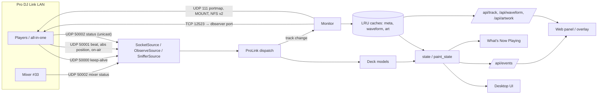
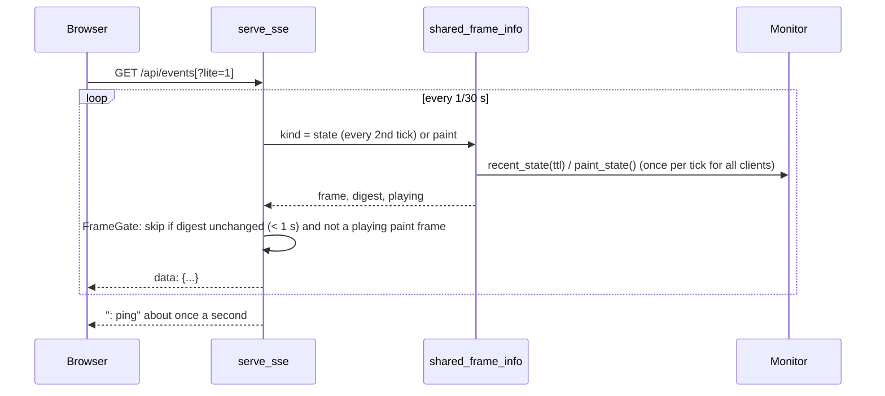
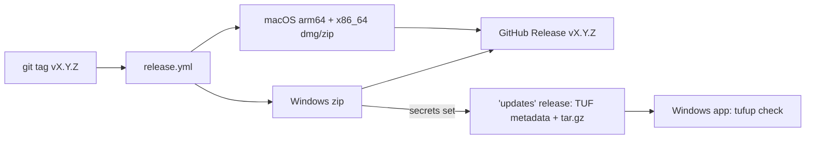

# Architecture

How prolink-monitor is put together, for contributors. Protocol details are in [protocol.md](protocol.md); HTTP shapes in [api.md](api.md).

**Invariant: read-only.** Nothing in the tree writes to a player, a USB stick, `export.pdb`, `exportLibrary.db` or `master.db`. Network traffic towards players is limited to keep-alives (virtual device mode), dbserver *queries*, and NFS `MOUNT`/`LOOKUP`/`READ`/`GETATTR`. Model profiles can only switch requests *off*.

## Module map

### Entry points

| File | Role |
|---|---|
| `desktop.py`, `gui/__main__.py`, `gui/app.py` | Desktop app (PySide6). Single-instance check, update check, main window |
| `app.py` | `Monitor` (state, caches, library glue), HTTP `Handler`, port fallback (`open_http_server`), CLI (`python app.py`) |
| `monitor.py` | Console monitor |
| `probe.py` | Status-byte probe and `.plc` capture replay |

### `prolink/` — engine (no Qt)

| Module | Responsibility |
|---|---|
| `proto.py` | Packet constants, parsers (`parse`, `parse_xz_mixer_status`, `claim_stage`), keep-alive builder, playhead position helpers |
| `link.py` | `SocketSource` (virtual device), `ObserveSource`, `SnifferSource` (tshark); `Deck` (position model, loops); `ProLink` (dispatch, devices, AZ/XZ state); interface discovery |
| `allinone.py` | All-in-one units, device-number choice (`AUTO_ORDER`, `XZ_AUTO_ORDER`), USB-link adapter scoring, slot labels and NFS export mapping |
| `models.py` | Model profiles and `resolve()` |
| `link_timing.py` | Rolling 30 s status-timing stats for Health |
| `capture.py` | Listen-only packet capture to `.plc` |
| `playhead_smooth.py` | Rate-limited playhead corrections |
| `nfs.py` | ONC-RPC / portmap / MOUNT v1 / NFS v2 client over UDP, adaptive timeouts |
| `library.py` | Per-host media: NFS mount, `export.pdb` cache, ANLZ reads, refresh |
| `pdb.py` | `export.pdb` parser |
| `onelibrary.py`, `pysqlcipher_dialect.py`, `onelibrary_check.py` | Optional `exportLibrary.db` via pyrekordbox/SQLCipher |
| `anlz.py`, `anlz_resolve.py` | ANLZ tag parser and waveform decoding (numpy when available); choosing which library row/ANLZ path to trust |
| `remotedb.py`, `remotedb_client.py`, `db_recovery.py` | dbserver wire format, read-only menu session, reconnect with backoff |
| `library_tree.py` | Playlist tree shared by live and fallback sources |
| `artwork.py`, `artwork_util.py`, `art_header.py`, `embedded_art.py`, `hires_art.py` | Artwork from dbserver, NFS, local mirror, or the audio file's tag header |
| `track_key.py`, `lru.py` | Cache keys (device + medium + slot + id); bounded LRU with pinning |
| `mixstatus.py`, `audience_deck.py` | SmartTiming setlist (from prolink-connect); live audience-deck pick |
| `session.py` | Session recorder and exports |
| `countdown.py`, `fields.py`, `vocal.py`, `wavestyle.py`, `wavezoom.py` | Display helpers shared by Qt and web |
| `web_server.py` | `PanelServer` (thread caps, clean rebind) and SSE (`serve_sse`, shared frames, `FrameGate`) |
| `wnp.py` | What's Now Playing client |
| `loopback_audio.py` | Optional system-audio spectrum |
| `single_instance.py`, `shutdown.py`, `applog.py`, `paths.py`, `bundle.py`, `panel_launch.py` | Process plumbing |

### `gui/` — desktop shell

| Module | Responsibility |
|---|---|
| `backend.py` | Owns the `Monitor`, the HTTP server thread, the 20 Hz state timer and the precise paint timer, a 2-worker warm-up pool, and the `track_ready` signal |
| `main_window.py` | Sidebar, stacked pages, hotkeys, tray |
| `pages.py` | Monitor, Devices, Health, Library, Session, Overlay, Settings, About |
| `widgets.py`, `deck_fit.py`, `deck_layout.py` | Deck cards and waveform painting |
| `floating_now.py`, `overlay_now.py`, `overlay_url.py` | Floating window (Qt WebEngine) and overlay URLs |
| `health_timing.py` | Link-timing table and capture controls |
| `settings.py` | `DEFAULTS`, load/save, normalisation |
| `theme.py`, `icons.py`, `i18n.py` | Look, Phosphor icons, strings |

### `web/` — browser clients

| File | Role |
|---|---|
| `index.html` | Web panel (full event stream) |
| `overlay.html` | OBS overlay and floating window (lite event stream) |
| `playhead.js` | Client playhead smoothing (same numbers as `playhead_smooth.py`) |
| `wavepack.js` | Waveform block decoder, styles, zoom limits |
| `spectrum.js` | Visualiser |
| `wavepalette.json` | 3-band palettes; injected into HTML by the server so Qt and web share one definition |

### `updater/`, `packaging/`, `scripts/`

Signed updates (tufup), PyInstaller spec and bundle check, TUF `root.json`, screenshot and benchmark scripts.

## Threads

| Thread (name) | Owner | Work |
|---|---|---|
| Qt main | `gui` | UI, 20 Hz state tick (cache-only reads), paint timer (`poll_hz`, `Qt.PreciseTimer`) |
| `prolink-link` ×3 | `SocketSource` | `recvfrom` on UDP 50000/50001/50002 |
| `prolink-announce` | `SocketSource` | Listen 3 s, pick a number, keep-alive every 1.5 s, move on conflict |
| `prolink-sniffer` | `SnifferSource` | Reads tshark output |
| `prolink-track` | `ProLink` | One per track change: resolve medium, ANLZ, metadata |
| `prolink-preload`, `prolink-dbserver` | `Monitor` | Library preload; dbserver probing per host |
| `prolink-warm-*` (pool of 2) | `backend` | Cache misses from the UI tick; emits `track_ready` |
| `prolink-http`, `prolink-http-accept`, request threads | `PanelServer` | HTTP; ≤ 32 request threads, ≤ 12 SSE clients |
| `prolink-http-restart` / `-shutdown` | `backend` | Rebind / stop the server |
| `prolink-instance`, `prolink-instance-cmd` | `single_instance` | Second-launch commands on 127.0.0.1:47331 |
| `wnp-remote`, `wnp-test` | `wnp` | What's Now Playing sends |
| `spectrum-loopback` | `loopback_audio` | System-audio bins |

## Data flow

1. **Join.** `SocketSource` binds 50000–50002 on `0.0.0.0`, listens for `DISCOVERY_WINDOW` (3 s), records announced and final-claim numbers, picks a free one (`allinone.choose_device_number`), and broadcasts a keep-alive every 1.5 s to the subnet broadcast and `255.255.255.255`. A final-stage claim or a "number in use" packet naming our number moves us to another. `ObserveSource` binds but never announces.
2. **Status.** `ProLink._on_packet` parses each datagram. Keep-alives fill `devices` and the two-path detector; beat and Absolute Position packets update the `Deck`; status packets update the deck, link timing, AZ/XZ mode, and fire `on_track_change` in a new thread when the track id changes. Mixer status (type `0x29`) feeds the XZ mixer state; Channels On-Air feeds `mixer_on_air`.
3. **Metadata.** `Monitor._on_track_change` resolves the host and medium (export by slot), asks dbserver for title/artist/etc. when the profile allows, mounts NFS, reads `export.pdb` (and `exportLibrary.db` when it has the same id), chooses the ANLZ path, reads `.DAT`/`.EXT`/`.2EX`, and builds the waveform payload and the metadata dict. A title can be published before the analysis lands; the full entry replaces it. If NFS gives nothing, `_analysis_from_dbserver` reads PWV5, PWV3, PWV7 and PQTZ over dbserver. Missing waveforms and grids are retried after 3, 8 and 20 s, with a negative cache to avoid hammering.
4. **Caches.** Waveforms and metadata: `BoundedLRU(50)` each; artwork: 48 entries / 24 MB. Keys are `track_key` (device + export + PDB fingerprint + slot + id). Tracks on a deck are pinned. Library totals are cached until the media set changes.
5. **Output.** `Monitor.state()` builds a full snapshot from cache only (no I/O); `paint_state()` is the small per-frame subset. The desktop UI and the SSE streams share the most recent snapshot (`recent_state`).

## Event stream

`/api/events` is Server-Sent Events. `serve_sse` loops at the paint rate (30 Hz) and sends a **state** frame every second tick (15 Hz) and **paint** frames in between.

| Frame | `paint` | Contents |
|---|---|---|
| Full state | `false` | Everything in `/api/state` |
| Lite state (`?lite=1`) | `false` | Only `t, paint, decks, display, spectrum, audience_deck, now_playing, pending, setlist, mix` |
| Paint | `true` | `t, decks` (position, speed, loop, flags), `audience_deck`, `display` subset, `spectrum` when loopback |

- One encoded frame per kind per tick is shared by every client (`_FRAMES`); a lite frame is cut from the same full snapshot.
- Unchanged frames (digest ignoring `t` and `playhead_age_s`) are skipped but re-sent at least every 1 s. Paint frames are always sent while any deck plays.
- Writes time out after 2 s; a closed peer ends the stream. A 13th concurrent stream gets 503.

Clients merge paint frames into the last full state. The web panel and overlay re-fetch title-only metadata up to 4 times with growing gaps.

## Playhead smoothing

Same rules in `prolink/playhead_smooth.py` (desktop) and `web/playhead.js` (web):

| Mode | Large error (≥ 80 ms) | Small error |
|---|---|---|
| `direct` | snap | snap |
| `normal` | ≤ 15 % of one packet's travel | ≤ 8 % |
| `strong` | ≤ 8 % | ≤ 4 % |

Nominal packet interval 1/6 s. After 1 s without a packet the needle holds. Seeks (jump > 400 ms), pauses, reverses, loop wraps and track changes snap. In a loop the position is folded into `[loop_start, loop_end]`. CDJ-3000-class Absolute Position packets, when present, replace the beat-grid estimate (`position_source`: `exact` or `beat_grid`). The desktop draws the scrolling wave from a full-resolution cache with a sub-pixel offset and only lets the displayed playhead move forward between packets.

## HTTP caching and compression

| Resource | `Cache-Control` | ETag | gzip |
|---|---|---|---|
| HTML, JS, JSON files in `web/` | `no-cache` (+ `Pragma: no-cache` and `X-Asset-Version` for HTML) | yes (BLAKE2b of body) | yes, if > 1 KB |
| `/api/waveform/<id>` with `key` | `private, max-age=60` | yes | yes |
| `/api/artwork/<id>` with `key` | `private, no-cache` (art may upgrade to hi-res) | yes | no (JPEG) |
| Same without `key`, and all JSON API | `no-store` | no | JSON yes if > 1 KB |
| `/api/events` | `no-cache` | no | no |

`If-None-Match` matching returns 304 with no body. gzip honours `q=0`.

## Web server lifecycle

`open_http_server` binds the requested port (12 retries × 0.1 s for a reconnect), then 8787, 8877, 9777, 18777, then 0 (any). On Windows it reads `netsh interface ipv4 show excludedportrange protocol=tcp` and skips excluded ports, and binds without `SO_REUSEADDR` first (with it, a free port can fail with WinError 10013). `PanelServer` closes the listen socket and every client socket on shutdown, so the same port can be rebound by **Restart web server** or a reconnect.

## Update system

- `updater/check.py` queries the `updates` release with tufup, trusting only the bundled `root.json`.
- `updater/startup.py`: on a frozen Windows build **Yes** downloads and `updater/apply.py` replaces the app folder (never the settings or cache folders) and restarts. Elsewhere (macOS, source) it opens the Releases page.
- Keys are created with `scripts/tuf_init_keys.py`; CI signs with `TUFUP_KEYS_B64` / `TUFUP_KEY_PASSWORD`. Without secrets the release still publishes, unsigned metadata is skipped.

## Build and CI

| Workflow | Trigger | Jobs |
|---|---|---|
| `Tests` (`ci.yml`) | pull request, push to `main` | pytest on `ubuntu-latest`, `windows-latest`, `macos-14` × Python 3.12, 3.14 (Qt offscreen) |
| `Release builds` (`release.yml`) | pull request, `v*` tag, manual | `build-windows` (PyInstaller folder build, Python 3.14); `build-macos` matrix `arm64` on `macos-14` and `x86_64` on `macos-15-intel` (`.app` → dmg + zip, checked by `packaging/verify_bundle.py`); on tags `publish` creates the GitHub Release and signs update metadata; manual run `publish-existing` re-signs an existing tag's zip |

Both macOS architectures are built on every PR and tag; README text calling the Intel build optional/manual predates this. Release steps: bump `__version__` in `prolink/__init__.py`, merge, push tag `v<version>` (must match or the build stops).

## Tests

58 files, about 550 tests under `tests/`, run with `pytest`. They are offline: packet bytes, ANLZ fixtures (`tests/fixtures/anlz`), fake monitors and Qt offscreen. Areas: protocol parsing and per-model behaviour (`test_xz_*`, `test_az_anlz`, `test_blt_findings`, `test_source_slots`), playhead and loops, waveform decoding and zoom, library and dbserver, artwork, SSE and web performance (`test_web_perf_1021`, `test_web_reconnect`), Health layout, floating window, updates, WNP, session. `conftest.py` stops pytest collecting imported helpers and exits before Qt's atexit handler on CI.
