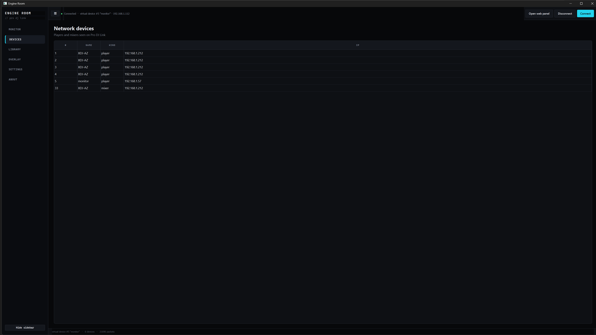
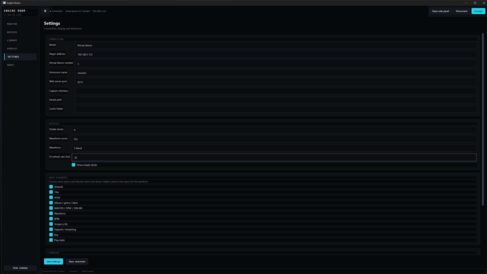

# User guide

Prolink Listener joins a Pro DJ Link network as a virtual player, reads track metadata, waveforms, cues and artwork from the players while the set runs, and shows them on the desktop, in a browser, and as an OBS overlay.

> **Read-only.** The app never writes to a player, a USB stick, or any rekordbox database. It only announces itself, listens, and asks read-only dbserver and NFS questions.

- [Install](#install)
- [First run](#first-run)
- [Connecting](#connecting)
- [Pages](#pages)
- [Web panel](#web-panel)
- [OBS overlay](#obs-overlay)
- [Floating overlay](#floating-overlay)
- [What's Now Playing](#whats-now-playing)
- [Updates](#updates)
- [Files and folders](#files-and-folders)
- [Troubleshooting](#troubleshooting)
- [FAQ](#faq)

## Install

Download from the [Releases](https://github.com/johnnycoombes/prolink-monitor/releases) page. Pick a versioned release (`v1.0.23` or later). Ignore the release named `updates`: it holds signed metadata for the in-app updater, not an installer.

| Platform | File | Notes |
|---|---|---|
| Windows 10/11 (64-bit) | `ProlinkListener-<version>-win64.zip` | Folder build; updates itself |
| macOS, Apple Silicon | `ProlinkListener-<version>-macos-arm64.dmg` (or `.zip`) | Not signed or notarised; does not update itself |
| macOS, Intel | `ProlinkListener-<version>-macos-x86_64.dmg` (or `.zip`) | Same as arm64. See note below |

**About the Intel build.** Earlier README text says the Intel Mac build is optional and built by hand. The current `Release builds` workflow (`.github/workflows/release.yml`) builds **both** `arm64` (on `macos-14`) and `x86_64` (on `macos-15-intel`) for every pull request and every `v*` tag, and attaches both to the GitHub Release. Intel is tested less (the test matrix runs on `macos-14` only), so treat it as best effort.

### Windows

1. Extract the zip to a folder you keep, for example `C:\Users\<you>\Prolink Listener`. Do not run it from inside the zip.
2. Run `ProlinkListener.exe`.
3. When Windows Firewall asks, allow **private networks**. Phones and the TV/tablet panel need that.

No Python is needed. The zip bundles `pyrekordbox` and `sqlcipher3`, so OneLibrary (`exportLibrary.db`) opens without extra installs. Npcap is only needed for Passive capture (see [Connecting](#connecting)).

### macOS (12 or later)

1. Open the dmg and drag **ProlinkListener** into **Applications**.
2. First launch: Gatekeeper blocks unsigned apps. Right-click → **Open** → **Open** (macOS 15+: try once, then **System Settings → Privacy & Security → Open Anyway**), or run once:
   ```bash
   xattr -dr com.apple.quarantine /Applications/ProlinkListener.app
   ```
3. Allow **Local Network** access when asked (the bundle declares `NSLocalNetworkUsageDescription`). Without it no player appears. Change later in **System Settings → Privacy & Security → Local Network**.
4. Passive capture on macOS needs Wireshark's `tshark` and its ChmodBPF helper.

### From source

Python 3.10–3.14 (CI uses 3.12 and 3.14).

```bash
pip install -r requirements.txt              # PySide6, PySide6-Addons, Pillow
python desktop.py                            # or: python -m gui
```

Optional extras: `tufup>=0.10,<0.11` (update check), `requirements-onelibrary.txt` (OneLibrary), `soundcard` (overlay visualiser from system audio).

Other entry points:

| Command | What it runs |
|---|---|
| `python app.py` | Web panel and HTTP API only, no desktop window |
| `python monitor.py` | Console monitor |
| `python probe.py` | Prints status bytes that change (`--all` keeps noisy fields) |
| `python probe.py --replay file.plc` | Replays a Health capture; sends nothing |

`app.py` flags: `--host`, `--mode auto|vcdj|sniffer|observe`, `--port` (8777), `--http-host` (`0.0.0.0`), `--number` (5; `0` = automatic), `--model` (a key from the [model table](protocol.md#model-profiles), default `auto`), `--name` (`monitor`), `--tshark`, `--iface`, `--cache`, `--no-open`.

## First run

1. Connect the computer to the same network as the players (see below), then start the app.
2. **Connect** runs automatically (`auto_connect`, on by default). The app listens for about 3 s, notes every device number in use, then announces itself as device **5** (or the next free number).
3. Load a track. Title, waveform, cues and artwork appear on **Monitor** within a second or two; the first NFS read of a large `export.pdb` can take longer.
4. Open **Health** if nothing shows: it says which packets arrive and why the library is or is not available.

Only one copy runs at a time. A second launch asks the first one (on `127.0.0.1:47331`) to come forward. Extra flags on that second launch: `--open-panel` (or `--open-web`) opens the web panel, `--open-overlay` opens the overlay. While connected, closing or minimising hides to the tray (`close_to_tray`, `minimize_to_tray`); quit from the tray menu or **File → Exit**.

## Connecting

### Network path

| Path | Recommended for | Notes |
|---|---|---|
| **Ethernet to the LINK/LAN port**, or a switch shared with the players | Everything (XDJ-AZ, XDJ-XZ, CDJs) | Use **Virtual device** mode |
| **USB-B cable** (the unit's built-in USB network adapter) | XDJ-XZ only, when no LINK port is free | **Experimental and unreliable**: this hardware family's USB adapter drops out. Use **Observe only** |

Do not connect both at once. A unit reachable over two paths (for example USB audio cable plus Ethernet) delivers every packet twice; Health warns *seen on more than one network path*. Disable the USB network adapter (Windows: Settings → Network → Advanced network settings → Disable; macOS: System Settings → Network → adapter → Make Inactive).

### Modes (Settings → Connection → Mode)

| Mode | Key | What it does | Needs |
|---|---|---|---|
| Auto | `auto` | Virtual device if UDP 50002 is free, otherwise Passive capture | — |
| Virtual device | `vcdj` | Binds UDP 50000–50002, announces a device number, receives status by unicast, opens dbserver sessions | rekordbox closed |
| Passive capture | `sniffer` | Reads packets with `tshark` without binding the ports | Npcap/tshark, and another program (rekordbox) already linked |
| Observe only (USB link, experimental) | `observe` | Binds UDP 50000–50002 but **never announces** and never opens dbserver; tracks come from NFS only. Picks the USB/link-local adapter when no host is set. Falls back to tshark if the ports are taken | XDJ-XZ USB-B |

### Device model (Settings → Connection → Device model)

*Auto-detect* (default) picks a profile from the names devices announce: an all-in-one or player first, then a mixer, rekordbox last. You can fix it to one of: XDJ-AZ, XDJ-XZ, CDJ-3000X, CDJ-3000, CDJ-2000NXS2, CDJ-2000NXS, CDJ-2000, CDJ-900NXS, CDJ-900, XDJ-1000MK2, XDJ-1000, XDJ-700, XDJ-RX3, XDJ-RX2, XDJ-RX, XDJ-RR, OPUS-QUAD, OMNIS-DUO, DJM mixer, rekordbox. Names marked `*` in the picker come from documentation and are untested here. A profile only **skips** requests a model cannot answer (for example dbserver on the Opus Quad); it never sends anything extra. Full table: [protocol.md → Model profiles](protocol.md#model-profiles).

### Device number

`number` (default **5**; range 0–15). **0 = Auto**. A number another device announces, or claims in a final-stage claim, is never used. Auto order: 5, 6, 4, 3, 7, 8, 13, 14, 15; when an XDJ-XZ is seen: 3, 4, then the same order. Numbers 9–12 (Opus Quad decks), 17 (rekordbox), 25 and 33–47 (mixers) are never taken automatically. Health → **Device number** shows the number in use and why.

### Model notes

- **XDJ-AZ** (verified): decks 1–4 and mixer 33 on one IP. LAN port, Virtual device. USB 1 is reported as "USB", USB 2 as "SD" or slot 7.
- **XDJ-XZ** (untested on hardware): decks 1, 2 and mixer 33. LINK port + Virtual device + Device number Auto is recommended. It reports USB 1 as "SD" and USB 2 as "USB"; the app labels them USB 1 / USB 2. Please export a probe report (Health → **Export XZ probe report**).
- **Opus Quad** (limited): no dbserver, no beat packets. Decks reported as 9–12 are shown as 1–4. Use one USB at a time; track IDs can drift from `export.pdb`.
- **rekordbox** on the same network holds UDP 50000–50002, so use Passive capture or close rekordbox.

## Pages

The sidebar holds **Monitor, Devices, Health, Library, Session, Overlay, Settings, About**. Toggle it with **☰** or `Ctrl+B`.

| Shortcut | Action |
|---|---|
| `+` / `=` / `Ctrl+=` | Zoom in (fewer bars) |
| `-` / `Ctrl+-` | Zoom out |
| `Ctrl+B` | Show/hide sidebar |
| `Ctrl+R` | Start/stop session recording |
| `Ctrl+O` | Open the overlay URL |

### Monitor


One row per deck, laid out as decks 1–2 or 3–1–2–4 (`max_decks` 2 or 4). Each row can show artwork, title, artist, album/genre/label, MASTER / SYNC / ON AIR, BPM, tempo %, elapsed and remaining time, key, play state, the overview and the scrolling detail waveform. Toggle elements under **Settings → Deck elements** (`deck_show_*`); hide empty decks with `show_empty_decks`.

- **Waveform styles**: RGB (`PWV5`), 3-band (`PWV7` detail, `PWV6` overview), Blue (`PWV3`), or **Auto** (follows the colour the player reports at status byte `0xDA`, else `waveform_style_fallback`). 3-band palettes: *CDJ-3000* (default) or *Beat Link*. Band byte order is a setting (`pwv7_order`, `pwv6_order`; default low-mid-high).
- **Zoom**: bar buttons 1, 2, 4, 8, 16, 32 and **All**; mouse wheel over a wave zooms 2–96 s (×1.15 per notch); double-click resets.
- **Playhead**: Auto / Centre / Left (Left is a quarter of the width). Smoothing Direct / Normal / Strong (see [architecture](architecture.md#playhead-smoothing)).
- **Cues**: hot cues A–H in their colours; memory cues in red when they have no colour; stored loops as a bar along the top.
- **Phrase strip**, **vocal lane**, **Bar.beat counter** (`Bar 33.2 · Chorus`) and **NEXT countdown** (amber ≤ 10 s, red ≤ 3 s).
- Paint rate `poll_hz` (default 60, clamped 5–60); state refresh 20 Hz.

### Devices

Every player and mixer seen on the link: number, name, kind and IP.



### Health

Everything you need to diagnose a connection:

- **LINK**: mode, player, model (chosen/detected and capabilities), all-in-one units, device number, XDJ-AZ mode (*Pro DJ Link*, *4-deck / rekordbox lighting*, or *unknown* for the first 5 s), Observe-only status, XDJ-XZ mixer tempo and tempo master.
- **Deck position**: per deck, beat and Absolute Position packet counts and rates, and whether the playhead comes from Absolute Position or the beat grid.
- **Link timing** over 30 s: last status, interval, jitter, max gap, late (> 400 ms), sequence holes.
- **Library source** (live dbserver, NFS cache, or none) with the exact dbserver failure; **dbserver reconnects**; OneLibrary status; artwork source; **ANLZ path** per deck.
- **NFS latency** per mount: RTT, calls, timeouts.
- **What's Now Playing** status.
- **Web server**: listening, clients, threads, last error; **Restart web server** rebinds without dropping the link.
- **Capture**: 5–60 s listen-only packet recording to a `.plc` file (replay with `python probe.py --replay`).
- **Export XZ probe report**: read-only JSON (also `GET /api/xz-probe`).
- Warnings: two network paths, XDJ-XZ announced but no status in 15 s, web port fallback reason.

### Library


The full playlist tree (folders, smart playlists, any depth) and history, read live from the player's dbserver; the USB copy (`exportLibrary.db` via pyrekordbox, or `export.pdb`) is the fallback. Search tracks, open a playlist, see tracks currently on decks. **Diagnostics** saves a read-only JSON comparing the live tree with the USB copy (also `GET /api/library/diagnostics`).

### Session

**Record session** (`Ctrl+R`) logs on-air tracks with a set clock that pauses when nothing is on air. Export CSV, JSON or M3U. With `session_autosave` on, all three are written on Stop to `session_autosave_dir` (default `~/.prolink-monitor/sessions`).

### Overlay

Builds the OBS overlay URL from the overlay settings, shows a preview, and opens the floating window.


### Settings



Sections: **Connection, Display, Deck elements, Overlay, Session, What's Now Playing, Behaviour, Desktop**. Saved to `settings.json` (see [Files and folders](#files-and-folders)). **Connect / Save & reconnect** restart the link and the web server on the same port.

| Key | Default | Meaning |
|---|---|---|
| `mode` | `auto` | `auto`, `vcdj`, `sniffer`, `observe` |
| `device_model` | `auto` | A key from the model table |
| `host` | empty | Player IP; empty = auto-detect |
| `number` | `5` | Device number, 0 = Auto |
| `name` | `monitor` | Name announced on the link |
| `port` | `8777` | Web server port (tried first) |
| `http_bind` | `0.0.0.0` | `127.0.0.1` keeps the panel on this computer ("Allow phones on the same Wi-Fi" off) |
| `iface`, `tshark`, `cache` | empty | Capture interface, tshark path, cache folder |
| `local_music_root` | empty | Local mirror of the USB used for embedded covers |
| `hires_art_from_file` / `hires_art_max_mb` | on / `16` | Read the cover embedded in the audio file over NFS, capped (1–64 MB) |
| `max_decks` | `4` | 2 or 4 |
| `zoom_bars` / `zoom_bars_by_deck` | `4` / `{}` | Bars in the detail wave |
| `wave_zoom_seconds_by_deck` | `{}` | Wheel zoom per deck |
| `waveform_style` / `waveform_style_fallback` | `rgb` / `rgb` | `auto`, `rgb`, `3band`, `blue` |
| `waveform_palette` | `cdj3000` | or `beatlink` |
| `pwv7_order` / `pwv6_order` | `low_mid_high` | or `mid_high_low` |
| `show_phrases` / `show_vocals` / `show_next_cue` | on | Strips and countdown |
| `playhead_position` | `auto` | `auto`, `centre`, `left` |
| `playhead_smoothing` | `normal` | `direct`, `normal`, `strong` |
| `poll_hz` | `60` | Desktop paint rate |
| `show_empty_decks`, `deck_show_*` | on | Monitor layout |
| `overlay_layout` | `nowplaying` | `nowplaying`, `dual`, `minimal`, `setlist` |
| `overlay_now_style` / `overlay_now_pos` | `card` / `bl` | Style and position |
| `overlay_corner`, `overlay_decks` | `bl`, `1` | Other layouts |
| `overlay_waveform_style` | `rgb` | Overlay wave colour |
| `overlay_scale`, `overlay_accent` | `1`, empty | Size and accent |
| `overlay_show_tags` / `_bpm` / `_next` / `_spectrum` | on | Overlay elements |
| `overlay_spectrum_audio` | off | Drive the visualiser from system audio (needs `soundcard`) |
| `overlay_playing_only`, `overlay_mix` | on | Overlay deck selection |
| `floating_now_topmost` / `_transparent` | on | Floating window |
| `session_autosave` / `session_autosave_dir` | off / empty | Session export on Stop |
| `wnp_enabled` / `wnp_host` / `wnp_port` / `wnp_secret` | off / `localhost` / `8899` / empty | What's Now Playing |
| `auto_connect`, `start_web_server` | on | Behaviour |
| `minimize_to_tray`, `close_to_tray`, `check_for_updates` | on | Desktop |

## Web panel


**Open web panel** (or `python app.py`) serves a browser copy of the Monitor: decks, waveforms, cues, phrases, vocal lane, playhead, zoom (wheel and pinch, remembered in the browser) and countdown. It has no settings; it follows the desktop display settings. A short clip: [web-panel.mp4](../doc/web-panel.mp4).

**Port.** The server tries `port` (default **8777**) first, retrying briefly in case a reconnect still holds it. If it cannot bind, it tries **8787**, 8877, 9777, 18777, then any free port. On Windows, a port inside a `netsh … excludedportrange` block is skipped and the range is named in Health and the log. Settings keep 8777, so the next launch tries it again. Every link the app opens uses the port that actually listened.

```
http://127.0.0.1:8777/             # this computer
http://<computer-ip>:8777/         # phone/tablet/TV on the same network
http://<computer-ip>:8777/?readonly=1   # hides the Record button (also ?ro=1)
```

Replace 8777 with 8787 (or whatever Health shows) when the fallback was used. LAN access needs `http_bind` = `0.0.0.0` and the firewall allowing the app. Panel query parameters: `readonly=1`/`ro=1`; `vocals=0` and `next=0` only affect the offline `mock=1` demo.

## OBS overlay

Add a **Browser source** pointing at `http://127.0.0.1:<port>/overlay` and size it to your canvas (for example 1920×1080). The background is transparent. The **Overlay** page builds the URL from your settings.

### Layouts and styles

| `layout` | What it shows |
|---|---|
| `nowplaying` (default) | One deck (the audience track when `mix` is on) in a `style` |
| `dual` | Several decks across the window (`decks`, default 2); does not follow the audience pick |
| `minimal` | Compact now-playing line |
| `setlist` | Now playing plus a scrolling history (12 entries) |

| `style` (nowplaying only) | Look | `pos` |
|---|---|---|
| `card` (default) | Tall card, large cover, overview wave, time | `tl`, `tr`, `bl` (default), `br` (`left`/`right` alias `bl`/`br`) |
| `panel` | Full-width strip, larger cover, overview + scrolling detail wave, spectrum visualiser, elapsed / remaining time | `bottom` (default), `top` |
| `bar` | Same strip with a small cover; spectrum follows the same switch | `bottom` (default), `top` |


### URL parameters

All are read in `web/overlay.html`. Anything not listed is ignored.

| Param | Values | Default | Effect |
|---|---|---|---|
| `layout` | `nowplaying`, `dual`, `minimal`, `setlist` | `nowplaying` | Layout |
| `style` | `card`, `panel`, `bar` | `card` | Now-playing style |
| `pos` | card: `tl` `tr` `bl` `br`; strips: `bottom` `top` | `bl` / `bottom` | Position of that style |
| `corner` | `bl`, `br`, `tl`, `tr`, `center` | `bl` | Position for the other layouts |
| `decks` | `1`–`4` | `1` (`2` for dual) | Max decks |
| `playing` | `0` | on | `0` also shows decks without a playing track |
| `mix` | `0` | on | `0` disables SmartTiming audience pick |
| `wave` | `auto`, `rgb`, `3band`, `blue` | `rgb` | Waveform colour; `auto` follows the player |
| `wavefb` | `rgb`, `3band`, `blue` | `rgb` | What `wave=auto` draws when the player does not say |
| `palette` | `cdj3000`, `beatlink` | `cdj3000` | 3-band colours |
| `zoom` | seconds (clamped 2–96) | desktop bar zoom | Fixed scrolling-wave window |
| `spectrum` | `1`, `0` | on | Visualiser on panel and bar; `1`/`0` lock it regardless of the desktop switch |
| `barbeat` | `0` | on | Hide the `Bar 33.2` counter |
| `tags` | `0` | on | Hide MASTER / SYNC / ON AIR |
| `bpm` | `0` | on | Hide BPM |
| `next` | `0` | on | Hide the MixStatus "about to take over" lower third |
| `scale` or `font` | `0.5`–`2.5` | `1` | Size |
| `accent` | 6-digit hex, with or without `#` | — | Accent colour (deck 1 colour too) |
| `preview` | `1` | off | Dark background (local preview) |
| `embed` | `1` | off | Tighter frame |
| `float` | `1` | off | Floating-window mode |
| `mock` | `1` | off | Offline demo data, no server needed |
| `v` | any | — | Cache-buster added by the app |

There is no `band` parameter: 3-band is `wave=3band`. Overlays use the **lite** event stream (`/api/events?lite=1`) automatically; see [api.md](api.md#get-apievents).

With `mix` on, single-deck layouts follow the audience track: playing and on air for 128 beats, short drop-outs ignored (SmartTiming, from prolink-connect). The cue countdown follows the desktop **Next cue countdown** setting.

Examples:

```
http://127.0.0.1:8777/overlay?layout=nowplaying&style=panel&pos=bottom
http://127.0.0.1:8777/overlay?layout=nowplaying&style=bar&pos=top&spectrum=0
http://127.0.0.1:8777/overlay?layout=nowplaying&style=card&pos=br&wave=3band
http://127.0.0.1:8777/overlay?layout=dual&corner=tl&decks=4&playing=0
http://127.0.0.1:8777/overlay?layout=setlist&corner=bl&scale=1.25&accent=ff6b61
```

**Spectrum visualiser.** Pro DJ Link carries no audio, so the bars follow the analysed low/mid/high wave at the playhead and decay while paused. **Bar visualiser: use system audio** switches the input to WASAPI loopback (needs the optional `soundcard` package); it is not the on/off switch.

## Floating overlay


A frameless, always-on-top window showing the same now-playing overlay (`float=1&embed=1`), transparent by default. Drag the strip along the top, or **Alt+drag** anywhere. The card and the strip styles remember their own positions. It reloads when the web server comes back after a reconnect. Options: `floating_now_topmost`, `floating_now_transparent`.

## What's Now Playing

Off by default. **Settings → What's Now Playing**: enable, host (`localhost`), port (**8899**), optional shared secret. The audience track is sent once per change with `POST /v1/remoteinput` (secret in the `X-WNP-Client-Auth` header). No cover art is sent. **Test** checks `/v1/status`. If WNP is closed, the app keeps running and Health shows the error.

In What's Now Playing: **Core Settings → Source → Remote**, and keep **Output & Display → Web Server** enabled.

## Updates

| Build | Behaviour |
|---|---|
| Windows zip | A couple of seconds after start, checks for a newer **signed** release ([tufup](https://github.com/dennisvang/tufup)). **Yes** downloads it, replaces the app files, and restarts. Settings and cache are untouched |
| macOS | Same check; **Yes** opens the Releases page. Replace the app manually |
| Source checkout | Same check; **Yes** opens the Releases page; never overwrites the checkout |

Only updates signed for the `root.json` inside the app are accepted. Turn it off with **Settings → Desktop → Check for updates when the app starts**. Problems are logged to `update.log` in the settings folder.

## Files and folders

| What | Windows / Linux | macOS |
|---|---|---|
| Settings, log, sessions, captures | `~/.prolink-monitor/` (`settings.json`, `prolink-monitor.log`, `sessions/`, `captures/`) | `~/Library/Application Support/Prolink Listener/` |
| Library cache | `~/.prolink-cache/` | `~/Library/Caches/Prolink Listener/` |

`PROLINK_CONFIG_DIR` overrides the settings folder. The log rotates at about 1 MB with three backups. `PROLINK_NFS_READ_SIZE` (2048–8192, default 4096) tunes NFS read size.

## Troubleshooting

**Firewall.** Allow inbound UDP **50000–50002** (Pro DJ Link) and TCP on the web port. NFS uses UDP **111** (portmapper) plus whatever mount/NFS ports the player returns; dbserver uses TCP **12523** for port discovery, then the port the player returns. These last two are outbound from this computer. On Windows accept the private-network prompt.

**"could not open UDP port 50000".** rekordbox (or another Pro DJ Link app) holds 50000–50002 exclusively. Close it, or use Passive capture with Npcap/tshark.

**No decks.** Player on and on the same subnet; device number free; in Passive mode another program must be linked. Several virtual adapters (Hyper-V, VMware) can make auto-detect pick the wrong interface: set **Player address** (`--host`). "could not find interface": pass `--iface` with a number from `tshark -D`.

**Two network paths.** Health warning *seen on more than one network path*: disable the USB network adapter or unplug one path.

**XDJ-XZ: keep-alives but no status.** Health warns after 15 s. Use the LINK port with Virtual device, check for a number clash or a second path.

**Title but no waveform.** The stick must carry rekordbox analysis (`PIONEER/USBANLZ/...`). Health → ANLZ path shows what was resolved. NFS must be reachable: check NFS latency/timeouts on Health. As a last resort the app reads the main ANLZ tags over dbserver.

**Library empty or "dbserver" errors.** Health's library line names the failure: port discovery (TCP 12523), client number, or rejected setup. The NFS copy is used meanwhile. A `pyrekordbox.db6` deprecation warning is not an error.

**Web panel not reachable.** Check Health → Web server for the port that listened (8787 if 8777 failed). `PermissionError [WinError 10013]` usually means a Hyper-V/WSL excluded range: `netsh interface ipv4 show excludedportrange protocol=tcp`. Use **Restart web server** after a reconnect instead of starting a second copy.

**Waveforms look wrong in 3-band (kicks not blue).** Try **Settings → Display → 3-Band byte order** = *Mid, high, low*.

**Sending a report.** Health → **Capture** (a `.plc` file), **Export XZ probe report**, and Library → **Diagnostics** are all read-only JSON/packet files you can attach to an issue.

## FAQ

**Does it change anything on my player or USB?** No. Read-only by design: no database writes, no library edits, no remote control.

**Can I run it alongside rekordbox?** Yes, in Passive capture mode (Npcap/tshark), or close rekordbox to use Virtual device mode.

**Why device number 5?** It is outside the decks of a typical 4-deck setup and the XDJ-AZ's 1–4/33. Auto picks a free number if 5 is taken.

**Does it need internet?** No, except for the update check.

**Is there audio?** No. Pro DJ Link carries no audio; the overlay visualiser is driven by the analysis (or by system audio if you enable it).

**Which players are verified?** The XDJ-AZ. Others follow public packet layouts; see [protocol.md](protocol.md#model-profiles).
